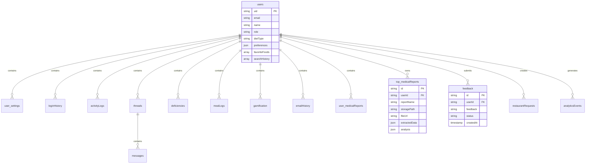
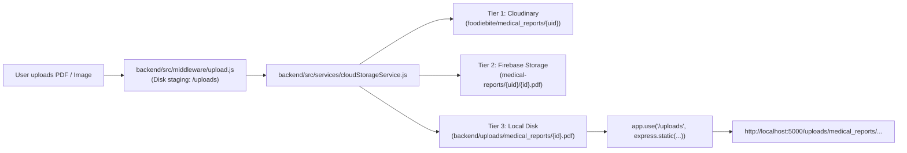
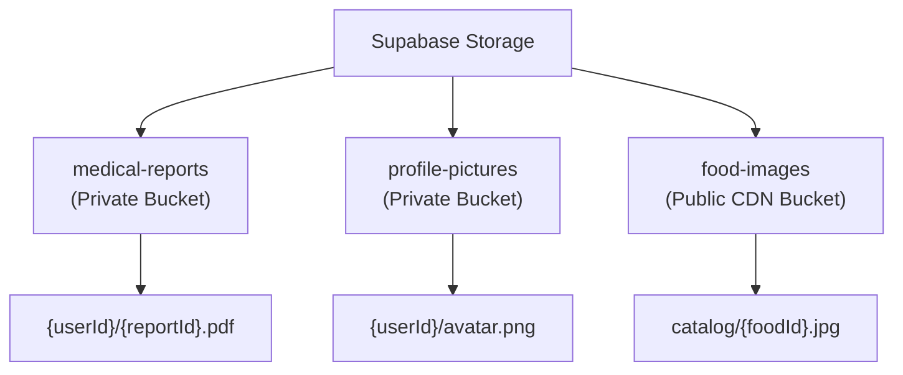
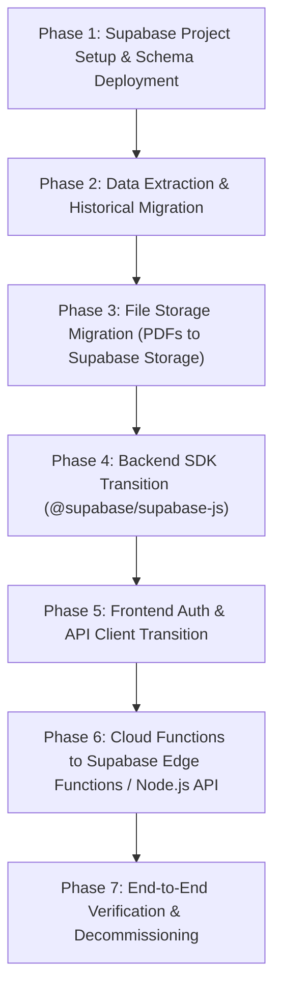

# Comprehensive Architecture & Migration Analysis: Migrating FoodieBite from Firebase & Cloudinary to Supabase

**Document Version:** 1.0.0  
**Date:** November 2, 2026  
**Author:** Senior Software Architect & Backend Migration Specialist  
**Project:** FoodieBite (Monorepo)  
**Target Architecture:** Supabase (PostgreSQL, Supabase Auth, Supabase Storage, Edge Functions / Node.js API)  
**File Name:** `FOODIEBITE_MIGRATION_ANALYSIS.md`

---

## Executive Summary

This document provides an exhaustive, source-code-verified architectural analysis of the **FoodieBite** application to prepare for a clean, zero-data-loss migration from **Google Firebase (Authentication, Firestore, Cloud Functions, Cloud Storage)** and **Cloudinary** to **Supabase (PostgreSQL, Supabase Auth, Supabase Storage, Row-Level Security)**.

Every statement, file path, endpoint, collection name, and data structure in this document has been verified against the physical codebase in `S:\files\food_app`.

---

## Section A: Complete Project Architecture

### 1. Repository & Directory Structure

FoodieBite is organized as a unified JavaScript monorepo:

```
s:\files\food_app\
├── .github\                    # CI/CD Workflows (GitHub Actions)
├── appium-tests\               # Mobile E2E functional test automation suite
├── backend\                    # Express.js REST API Server
│   ├── data\                   # JSON-backed durable local database fallbacks
│   ├── scratch\                # Test fixtures and temporary verification scripts
│   ├── scripts\                # Health, email, and diagnostic CLI runners
│   ├── src\
│   │   ├── ai\                 # Deterministic local AI nutrition & recommendation engines
│   │   ├── config\             # Firebase, biomarker rulesLoader, DB configs, units
│   │   ├── controllers\        # Express route handler controllers
│   │   ├── middleware\         # Auth tokens, error handling, correlation IDs, Multer
│   │   ├── models\             # Decommissioned Mongoose stubs (configured for Firebase)
│   │   ├── routes\             # 12 Express modular route files (108 endpoints)
│   │   └── services\           # Core business logic: emails, weather, OCR, storage
│   ├── uploads\                # Physical disk storage for medical reports & user uploads
│   └── package.json            # Backend dependencies
├── docs\                       # Architecture & release documentation
├── frontend\                   # React Native Web Client (Web & Mobile targets)
│   ├── android\                # Android native project wrapper
│   ├── public\                 # Static HTML entry point & favicon
│   ├── src\
│   │   ├── assets\             # Images, icons, and illustrations
│   │   ├── components\         # Reusable UI widgets, badges, cards, navigation
│   │   ├── context\            # AppContext.js (global user state, favorites, prefs)
│   │   ├── data\               # Static fallback datasets (dishes, tags)
│   │   ├── navigation\         # React Navigation container & route stacks
│   │   ├── screens\            # 24 functional screen views
│   │   ├── services\           # API client, Firebase adapters, local storage, OCR
│   │   └── utils\              # Responsive layout helpers and formatting
│   ├── webpack.config.js       # Webpack 5 bundling & reverse proxy config
│   └── package.json            # Frontend dependencies
├── functions\                  # Firebase Cloud Functions (v2 API)
│   ├── index.js                # 8 Cloud Functions (triggers, scheduler, https)
│   └── package.json            # Functions dependencies
├── reports\                    # Generated test and audit reports
├── scripts\                    # Monorepo build, load testing, and test runner scripts
├── selenium-tests\             # Browser automation test suite
├── firebase.json               # Firebase CLI configuration
├── firestore.rules             # Active Firestore security rules (121 lines)
├── storage.rules               # Active Firebase Storage security rules (25 lines)
└── package.json                # Monorepo root manifest
```

### 2. Frontend Architecture
* **Framework:** React 18 / React Native for Web (`react-native-web` v0.19)
* **Routing:** `@react-navigation/native` with `@react-navigation/native-stack`
* **Styling & Design System:** Pure StyleSheet API, responsive breakpoint utility (`frontend/src/utils/responsive.js`), Lucide icon library (`lucide-react-native`).
* **State Management:** React Context API via `frontend/src/context/AppContext.js` managing:
  - User session & token state
  - Dietary preferences & allergen exclusions
  - Real-time favorites list
  - In-app notification alerts
  - Dark/Light theme mode
* **Offline First Strategy:** Instant client rehydration via `frontend/src/services/localStorageService.js` prior to cloud auth verification.

### 3. Backend Architecture
* **Runtime:** Node.js v20+ with Express.js v4.21
* **API Paradigm:** RESTful JSON endpoints with Bearer token authentication
* **Security Layer:**
  - `helmet` with cross-origin resource policy
  - `cors` with origin whitelisting (`CLIENT_URL` / `http://localhost:3000`)
  - `express-rate-limit` per route group (`/api/auth`, `/api/food/search`, `/api/coach`, `/api/nearby`)
  - Request correlation tracing via `middleware/requestCorrelation.js`
* **Local Deterministic AI Engine:** Pure JavaScript decision trees in `backend/src/ai/` with zero external paid AI model dependencies for core recommendation, food safety, and meal planning.
* **OCR Ingestion:** Hybrid Tesseract.js engine with `pdf-parse` for clinical biomarker extraction.
* **Background Scheduling:** `node-cron` daily scheduler running in `backend/src/services/scheduler.js` triggered at `0 9 * * *` (`Asia/Kolkata`).

### 4. Complete API Inventory (108 Verified Endpoints)

| Route Group | Base Path | Total Endpoints | Key Operations |
| :--- | :--- | :---: | :--- |
| **Authentication** | `/api/auth` | 4 | Register, login, get current user (`/me`), update password |
| **User Profile & State** | `/api/user` | 17 | Profile sync, preferences, favorites (add/remove), search history, behavioral events |
| **Medical Reports** | `/api/medical` | 7 | PDF upload & OCR, list reports, get report by ID, delete report, health profile |
| **Food & Recommendations** | `/api/food` & `/api/foods` | 9 | Nutrition scanner (`/scan-nutrition`), personalized recommendations, search, compare, delivery link |
| **AI Coach** | `/api/coach` | 1 | AI health & diet consultation chat endpoint |
| **Email & Dispatch** | `/api/email` | 19 | Gmail SMTP verify, test email, daily recommendation trigger/preview/retry, campaign management, Brevo webhooks |
| **Feedback** | `/api/feedback` | 3 | User feedback submission, status resolution, deletion |
| **Administrator** | `/api/admin` | 24 | User management, CSV exports, notification settings, metrics, audit logs, restaurant approvals |
| **Analytics & Intelligence** | `/api/analytics` | 13 | Event tracking, summary, trends, user segmentation, A/B experiments |
| **Merchant** | `/api/merchant` | 3 | Restaurant onboarding submission, merchant request tracking |
| **Nearby Restaurants** | `/api/nearby` | 2 | OpenStreetMap Overpass discovery, Nominatim geocoding |
| **Restaurants** | `/api/restaurants` | 1 | List admin-approved merchant restaurants |
| **Operational & Health** | `/` (root) | 5 | `/health`, `/ready`, `/api/debug/ai`, `/api/debug/tars`, `/api/debug/firestore` |

### 5. Environment Variables Inventory

#### Backend (`backend/.env` & `backend/.env.example`)
* **Server & Ports:** `PORT` (5000), `NODE_ENV` (`development` / `production`), `CLIENT_URL` (`http://localhost:3000`)
* **Security & Tokens:** `JWT_SECRET`, `JWT_EXPIRE` (`7d`)
* **Upload Limits:** `MAX_FILE_SIZE` (`20971520` bytes = 20 MB), `UPLOAD_PATH` (`./uploads`)
* **Firebase Configuration (Current):** `FIREBASE_PROJECT_ID` (`food-app-3d216`), `GOOGLE_APPLICATION_CREDENTIALS` / `FIREBASE_SERVICE_ACCOUNT_PATH`, `FIREBASE_STORAGE_BUCKET` (`food-app-3d216.firebasestorage.app`)
* **Cloudinary Configuration (Current):** `CLOUDINARY_CLOUD_NAME` (`dvuv4dphe`), `CLOUDINARY_API_KEY` (`713876832411433`), `CLOUDINARY_API_SECRET` (`B4scjhdwRTz5bU3IuP9ZZWxAT1c`)
* **Email Services:** `SMTP_HOST` (`smtp.gmail.com`), `SMTP_PORT` (`587`), `SMTP_USER` (`foodiebite881@gmail.com`), `SMTP_PASS`, `SMTP_FROM`, `RESEND_API_KEY`, `RESEND_FROM`, `BREVO_API_KEY`
* **External Integrations:** `FOOD_DELIVERY_PROVIDER` (`mealme`), `MEALME_COMPANY_NAME`, `OPENWEATHER_API_KEY` (optional fallback)

#### Frontend (`frontend/.env`)
* **Backend API Base:** `REACT_APP_API_URL` (`http://localhost:5000/api`)
* **Firebase Client Keys (Current):** `REACT_APP_FIREBASE_API_KEY`, `REACT_APP_FIREBASE_AUTH_DOMAIN`, `REACT_APP_FIREBASE_PROJECT_ID`, `REACT_APP_FIREBASE_STORAGE_BUCKET`, `REACT_APP_FIREBASE_MESSAGING_SENDER_ID`, `REACT_APP_FIREBASE_APP_ID`
* **Cloudinary Client Keys (Current):** `REACT_APP_CLOUDINARY_CLOUD_NAME` (`dvuv4dphe`), `REACT_APP_CLOUDINARY_UPLOAD_PRESET` (`ml_default`)

---

## Section B: Firebase Analysis & Dependencies

### 1. Firebase Components Currently In Use
* **Firebase Authentication:**
  - Email & Password accounts
  - Google Sign-In (Web popup via `signInWithPopup`, Android via `GoogleSignin` native credential)
  - Token minting and client-side ID Token verification on backend (`admin.auth().verifyIdToken()`)
* **Cloud Firestore:**
  - Client-side direct reads and writes for profiles, preferences, favorites, and feedback
  - Backend server-side Admin SDK operations for metrics, analytics, audit logs, and email history
* **Firebase Storage:**
  - Declared in `storage.rules` and `frontend/src/services/firebase.web.js`
  - Bucket designated: `food-app-3d216.firebasestorage.app` (currently unprovisioned due to Blaze billing requirement, gracefully routed to local disk / Cloudinary)
* **Firebase Cloud Functions (v2):**
  - Trigger `onDocumentCreated("users/{userId}/activityLogs/{logId}")`
  - Trigger `onDocumentCreated("users/{userId}/loginHistory/{loginId}")`
  - Trigger `onDocumentCreated("users/{userId}")` (send welcome email)
  - Scheduler `onSchedule("0 * * * *")` (`dailyNutritionDispatcher`)
  - HTTPS `onRequest`: `sendTestSmartNutritionEmail`, `sendPasswordResetAlert`, `sendDailySuggestions`, `detectUserDeficiencies`
* **Firebase Security Rules:**
  - `firestore.rules`: 121 lines governing user ownership, subcollections, and admin access (`sham111205s@gmail.com`)
  - `storage.rules`: 25 lines governing `/medical-reports/{userId}`, `/profile_pictures/{userId}`, and `/food_images`

### 2. Verified File Inventory Importing or Using Firebase

#### Frontend Source Files:
1. [`frontend/src/services/firebase.js`](file:///s:/files/food_app/frontend/src/services/firebase.js) — Master re-export adapter
2. [`frontend/src/services/firebase.web.js`](file:///s:/files/food_app/frontend/src/services/firebase.web.js) — Web modular Firebase SDK initialisation (`firebase/app`, `firebase/auth`, `firebase/firestore`, `firebase/storage`)
3. [`frontend/src/services/firebase.android.js`](file:///s:/files/food_app/frontend/src/services/firebase.android.js) — Native Android adapter (`@react-native-firebase/*`)
4. [`frontend/src/services/googleAuth.web.js`](file:///s:/files/food_app/frontend/src/services/googleAuth.web.js) — `GoogleAuthProvider` & `signInWithPopup`
5. [`frontend/src/services/googleAuth.android.js`](file:///s:/files/food_app/frontend/src/services/googleAuth.android.js) — `signInWithCredential`
6. [`frontend/src/services/api.js`](file:///s:/files/food_app/frontend/src/services/api.js) — Direct Firestore calls (`getDoc`, `setDoc`, `updateDoc`, `arrayUnion`, `arrayRemove`)
7. [`frontend/src/services/medicalReportsService.js`](file:///s:/files/food_app/frontend/src/services/medicalReportsService.js) — Firestore report subscription & snapshot listeners
8. [`frontend/src/services/localStorageService.js`](file:///s:/files/food_app/frontend/src/services/localStorageService.js) — Session token cache adapter
9. [`frontend/src/context/AppContext.js`](file:///s:/files/food_app/frontend/src/context/AppContext.js) — `onAuthStateChanged` session listener
10. [`frontend/src/screens/HomeScreen.js`](file:///s:/files/food_app/frontend/src/screens/HomeScreen.js) — Direct auth check fallback
11. [`frontend/src/screens/AdminDashboardScreen.js`](file:///s:/files/food_app/frontend/src/screens/AdminDashboardScreen.js) — Admin verification
12. [`frontend/src/screens/MedicalReportsScreen.js`](file:///s:/files/food_app/frontend/src/screens/MedicalReportsScreen.js) — Report upload and cloud status
13. [`frontend/src/screens/AIScreen.js`](file:///s:/files/food_app/frontend/src/screens/AIScreen.js) — User context binding
14. [`frontend/src/screens/ChatScreen.js`](file:///s:/files/food_app/frontend/src/screens/ChatScreen.js) — Message history references
15. [`frontend/src/screens/AboutUsScreen.js`](file:///s:/files/food_app/frontend/src/screens/AboutUsScreen.js) — Static copy referencing Firebase
16. [`frontend/src/screens/PrivacyPolicyScreen.js`](file:///s:/files/food_app/frontend/src/screens/PrivacyPolicyScreen.js) — Privacy disclaimer referencing Firebase Auth & Firestore

#### Backend Source Files:
1. [`backend/src/config/firebase.js`](file:///s:/files/food_app/backend/src/config/firebase.js) — Singleton initializer for `firebase-admin`
2. [`backend/src/middleware/authMiddleware.js`](file:///s:/files/food_app/backend/src/middleware/authMiddleware.js) — `admin.auth().verifyIdToken(token)` & user disabled status check
3. [`backend/src/controllers/adminController.js`](file:///s:/files/food_app/backend/src/controllers/adminController.js) — Reads/writes to `users`, `admin_audit_logs`, `ai_logs`, `feedback`, `system`
4. [`backend/src/controllers/authController.js`](file:///s:/files/food_app/backend/src/controllers/authController.js) — Synchronizes user registration with Firestore `users` collection
5. [`backend/src/controllers/medicalController.js`](file:///s:/files/food_app/backend/src/controllers/medicalController.js) — Queries and writes to `medicalReports` collection
6. [`backend/src/controllers/coachController.js`](file:///s:/files/food_app/backend/src/controllers/coachController.js) — Reads/writes `users/{uid}/threads/{tId}/messages`
7. [`backend/src/controllers/analyticsController.js`](file:///s:/files/food_app/backend/src/controllers/analyticsController.js) — Aggregates user counts and meal logs from Firestore
8. [`backend/src/controllers/foodController.js`](file:///s:/files/food_app/backend/src/controllers/foodController.js) — Reads/writes `cachedFoods`
9. [`backend/src/controllers/nearbyController.js`](file:///s:/files/food_app/backend/src/controllers/nearbyController.js) — Loads user preference context from Firestore `users`
10. [`backend/src/services/cloudStorageService.js`](file:///s:/files/food_app/backend/src/services/cloudStorageService.js) — Tier 2 Firebase Storage bucket uploads and signed URLs
11. [`backend/src/services/activityTrackingService.js`](file:///s:/files/food_app/backend/src/services/activityTrackingService.js) — Writes to `feature_aggregates` and `admin_audit_logs`
12. [`backend/src/services/analyticsEventService.js`](file:///s:/files/food_app/backend/src/services/analyticsEventService.js) — Logs to `analyticsEvents`
13. [`backend/src/services/behaviorLearningService.js`](file:///s:/files/food_app/backend/src/services/behaviorLearningService.js) — Updates behavioral profile on Firestore `users`
14. [`backend/src/services/brevoService.js`](file:///s:/files/food_app/backend/src/services/brevoService.js) — Reads/writes `emailCampaigns`, `emailCampaignRecipients`, `email_unsubscribes`
15. [`backend/src/services/dailyRecommendationService.js`](file:///s:/files/food_app/backend/src/services/dailyRecommendationService.js) — Writes `dailyRecommendationRuns` and `dailyRecommendationRecipients`
16. [`backend/src/services/feedbackStore.js`](file:///s:/files/food_app/backend/src/services/feedbackStore.js) — Synchronizes user feedback with Firestore `feedback` collection
17. [`backend/src/services/mailService.js`](file:///s:/files/food_app/backend/src/services/mailService.js) — Logs dispatched emails to `email_logs`
18. [`backend/src/services/recommendationDbService.js`](file:///s:/files/food_app/backend/src/services/recommendationDbService.js) — Stores generated recommendations in `foodiebiteRecommendations`
19. [`backend/src/services/restaurantRequestStore.js`](file:///s:/files/food_app/backend/src/services/restaurantRequestStore.js) — Tracks `restaurantRequests` and `approvedRestaurants`
20. [`backend/src/services/segmentationService.js`](file:///s:/files/food_app/backend/src/services/segmentationService.js) — Stores clustering metadata in `segmentationModels`
21. [`backend/src/services/cacheService.js`](file:///s:/files/food_app/backend/src/services/cacheService.js) — Caches external food products in `cachedFoods`
22. [`backend/src/server.js`](file:///s:/files/food_app/backend/src/server.js) — Debug endpoint `/api/debug/firestore`

#### Functions Source Files:
1. [`functions/index.js`](file:///s:/files/food_app/functions/index.js) — Entire 896-line serverless module depends on `firebase-admin` and `firebase-functions/v2`.

---

## Section C: Cloudinary Analysis & Dependencies

### 1. Configuration
* **Account Cloud Name:** `dvuv4dphe`
* **API Key:** `713876832411433`
* **API Secret:** Configured in `backend/.env`
* **Client Upload Preset:** `ml_default`

### 2. Cloudinary Functionality & References

#### A. PDF Medical Report Upload & Storage (Tier 1 Cloud Storage)
* **File:** [`backend/src/services/cloudStorageService.js`](file:///s:/files/food_app/backend/src/services/cloudStorageService.js#L50-L83)
* **Implementation:**
  ```javascript
  cloudinary.uploader.upload(localTempPath, {
    resource_type: 'auto',
    folder: `foodiebite/medical_reports/${cleanUserId}`,
    public_id: reportId,
    overwrite: true
  });
  ```
* **Storage Path in Cloudinary:** `foodiebite/medical_reports/{userId}/{reportId}.pdf`

#### B. PDF Deletion
* **File:** [`backend/src/services/cloudStorageService.js`](file:///s:/files/food_app/backend/src/services/cloudStorageService.js#L140-L152)
* **Implementation:** Calls `cloudinary.uploader.destroy(publicId, { resource_type: 'image' })` and `resource_type: 'raw'`.

#### C. Food Image Resolution
* **File:** [`frontend/src/services/foodHelpers.js`](file:///s:/files/food_app/frontend/src/services/foodHelpers.js#L122-L126)
* **Implementation:** Resolves non-URL image identifiers into Cloudinary CDN image delivery URLs:
  ```javascript
  const cloudName = process.env.REACT_APP_CLOUDINARY_CLOUD_NAME || 'dvuv4dphe';
  resolved = `https://res.cloudinary.com/${cloudName}/image/upload/f_auto,q_auto/${trimmed}`;
  ```

#### D. Dependent Components
* [`frontend/src/services/medicalReportsService.js`](file:///s:/files/food_app/frontend/src/services/medicalReportsService.js#L146-L150): Detects `storageProvider: 'cloudinary'` and formats preview/download URLs.
* [`frontend/src/screens/MedicalReportsScreen.js`](file:///s:/files/food_app/frontend/src/screens/MedicalReportsScreen.js): Displays CDN status badge (`Cloud Storage (Cloudinary)`).
* [`frontend/src/screens/HomeScreen.js`](file:///s:/files/food_app/frontend/src/screens/HomeScreen.js), [`frontend/src/screens/SearchScreen.js`](file:///s:/files/food_app/frontend/src/screens/SearchScreen.js), [`frontend/src/screens/FoodDetailScreen.js`](file:///s:/files/food_app/frontend/src/screens/FoodDetailScreen.js): Render food images resolved via `foodHelpers.js`.

---

## Section D: Complete Firestore Collection Inventory

Across the application, exactly **30 collections and subcollections** were discovered and verified:



### Detailed Collection Breakdown

| Collection Name | Hierarchy / Path | Purpose & Contents | Record Volume in Code/Data |
| :--- | :--- | :--- | :---: |
| **`users`** | `/users/{userId}` | Master user profile: email, name, role (`user`/`admin`), `dietType`, `preferences`, `favoriteFoods` (array), `searchHistory` (array), `disabled`, `lastSignInTime`. | Primary (8 active records in `users_directory.json`) |
| **`settings`** | `/users/{userId}/settings/preferences` | User notification & email delivery preferences (`dailySuggestions`, `deliveryTime`, `frequency`). | Subcollection |
| **`loginHistory`** | `/users/{userId}/loginHistory/{id}` | Audit of logins: IP address, user agent, geolocation, device hash. | Subcollection |
| **`activityLogs`** | `/users/{userId}/activityLogs/{id}` | User action trail (profile update, password change, favorite toggle). | Subcollection |
| **`threads`** | `/users/{userId}/threads/{threadId}` | AI Coach conversation sessions. | Subcollection |
| **`messages`** | `/users/{userId}/threads/{tId}/messages/{msgId}` | Chat messages between user and AI coach (`sender`, `text`, `timestamp`, `options`). | Subcollection |
| **`deficiencies`** | `/users/{userId}/deficiencies/{defId}` | Detected dietary deficiencies (e.g. Vitamin B12, Iron, Protein deficit). | Subcollection |
| **`mealLogs`** | `/users/{userId}/mealLogs/{logId}` | Nutritional meal diary logged by user (`foodName`, `calories`, `macros`, `loggedAt`). | Subcollection |
| **`gamification`** | `/users/{userId}/gamification/{docId}` | User streak tracking, badges, points, healthy eating levels. | Subcollection |
| **`emailHistory`** | `/users/{userId}/emailHistory/{histId}` | Record of sent emails, delivery status, template used, timestamp. | Subcollection |
| **`medicalReports` (Sub)** | `/users/{userId}/medicalReports/{reportId}` | User-scoped copy of medical reports. | Subcollection |
| **`medicalReports` (Top)** | `/medicalReports/{reportId}` | Top-level collection for all clinical lab reports, OCR text, biomarker findings, storage URL, confidence score. | 11 stored documents |
| **`feedback`** | `/feedback/{feedbackId}` | User support requests, ratings, feedback text, status (`pending`/`resolved`). | Submissions from web |
| **`restaurantRequests`** | `/restaurantRequests/{reqId}` | Merchant applications to list restaurants (`restaurantName`, `ownerUid`, `status`). | Merchant workflow |
| **`approvedRestaurants`**| `/approvedRestaurants/{restId}`| Public verified restaurant catalog with menu, location coordinates, cuisines. | Public catalog |
| **`cachedFoods`** | `/cachedFoods/{foodId}` | Local cache of external food items fetched from Open Food Facts. | Dynamic cache |
| **`dailyRecommendationRuns`** | `/dailyRecommendationRuns/{runId}` | Daily batch execution log of personalized recommendation email job. | Scheduler audit |
| **`dailyRecommendationRecipients`** | `/dailyRecommendationRecipients/{recipId}` | Individual user delivery tracking for daily recommendation emails. | Scheduler audit |
| **`emailCampaigns`** | `/emailCampaigns/{campaignId}` | Marketing & broadcast email campaigns managed via Brevo. | Admin campaigns |
| **`emailCampaignRecipients`** | `/emailCampaignRecipients/{recipId}` | Per-user recipient progress for broadcast campaigns. | Admin campaigns |
| **`email_events`** | `/email_events/{eventId}` | Inbound webhook events (opened, delivered, bounced, spam complaint). | Webhooks |
| **`email_logs`** | `/email_logs/{logId}` | Nodemailer / Gmail SMTP system email delivery log. | Diagnostic logs |
| **`email_unsubscribes`**| `/email_unsubscribes/{email}` | Suppressed email addresses that opted out of recommendations. | Compliance registry |
| **`analyticsEvents`** | `/analyticsEvents/{eventId}` | Behavioral analytics tracking (clicks, impressions, search queries, filters). | 185 records in `analytics_events.json` |
| **`feature_aggregates`**| `/feature_aggregates/{date}` | Daily roll-ups of feature usage (searches, favorites, scans, logins). | 5 daily summaries in `analytics_daily.json` |
| **`admin_audit_logs`** | `/admin_audit_logs/{logId}` | Immutable audit log of administrative actions (disabling users, resolving feedback). | Admin audit |
| **`ai_logs`** | `/ai_logs/{logId}` | Query logs of AI assistant interactions and response latency. | AI monitoring |
| **`segmentationModels`**| `/segmentationModels/{modelId}` | Metadata of ML user clusters and affinity centroids. | ML clustering |
| **`foodiebiteRecommendations`** | `/foodiebiteRecommendations/{recId}` | Cached personalized food recommendations per user profile. | Recommendation engine |
| **`system`** | `/system/{configId}` | Global application configuration (`system/notifications`). | System config |
| **`apiHealth`** | `/apiHealth/{pingId}` | Keepalive heartbeat record for monitoring backend connectivity. | Internal ping |
| **`searchHistory`** | `/searchHistory/{queryId}` | Global search query trends. | Analytics |

---

## Section E: Authentication Architecture

### 1. Existing Authentication Mechanisms

```mermaid
flowchart TD
    subgraph Client ["Client (React Native Web)"]
        UI["Sign-In Screen"]
        GoogleBtn["Google Sign-In Button"]
    end

    subgraph Firebase ["Firebase Auth"]
        FB_EP["Email/Password Provider"]
        FB_G["Google OAuth Provider"]
    end

    subgraph Backend ["Express.js API"]
        MW["authMiddleware.protect"]
        AdminGuard["authMiddleware.requireAdmin"]
        FB_Admin["firebase-admin verifyIdToken()"]
        JWT_Fallback["jwt.verify(token, JWT_SECRET)"]
    end

    UI -->|email + password| FB_EP
    GoogleBtn -->|OAuth popup / credential| FB_G
    FB_EP -->|ID Token (JWT)| Client
    FB_G -->|ID Token (JWT)| Client

    Client -->|Authorization: Bearer ID_Token| MW
    MW --> FB_Admin
    FB_Admin -.->|Fallback on error| JWT_Fallback
    MW --> AdminGuard
    AdminGuard -->|email == 'sham111205s@gmail.com'| AdminPrivileges["Role: admin"]
```

#### A. Email / Password Authentication
* **Client Handled in:** `frontend/src/services/api.js` (`apiRegister`, `apiLogin`) via `createUserWithEmailAndPassword` and `signInWithEmailAndPassword`.
* **Backend Handled in:** `backend/src/controllers/authController.js` (`register`, `login`). Synchronizes registered accounts into `userStore` and Firestore `users` collection.

#### B. Google Sign-In
* **Web Target:** `frontend/src/services/googleAuth.web.js` invokes Firebase `signInWithPopup(auth, new GoogleAuthProvider())`.
* **Mobile / Android Target:** `frontend/src/services/googleAuth.android.js` initializes Google Play Services via `@react-native-google-signin/google-signin` with `webClientId: 433101398092-qd8ui8oog0mbhipv5dra31l55f4klm8u.apps.googleusercontent.com`, extracts the ID token, and bridges to Firebase with `signInWithCredential`.

#### C. Administrator Authentication & Permissions
* **Authorized Administrator:** Strictly verified in `backend/src/middleware/authMiddleware.js` and `firestore.rules`:
  ```javascript
  const AUTHORIZED_ADMIN_EMAIL = 'sham111205s@gmail.com';
  ```
* **Enforcement:**
  - Standard users attempting to access `/api/admin/*` receive `HTTP 403 Forbidden: Access denied. Authorized administrator privileges required.`
  - In `firestore.rules`, all write operations to `/feedback`, `/system`, and `/admin_audit_logs` enforce:
    ```javascript
    function isAdmin() {
      return request.auth != null &&
        request.auth.token.email != null &&
        request.auth.token.email.lower() == 'sham111205s@gmail.com';
    }
    ```

#### D. Session Management & Token Verification
* **Token Transport:** Standard HTTP header `Authorization: Bearer <token>`.
* **Verification Pipeline (`backend/src/middleware/authMiddleware.js`):**
  1. Checks for dev mock tokens (`mock_guest_token_dev_2026`, `token_*`).
  2. Primary: Decodes token using Firebase Admin SDK: `await adminApp.auth().verifyIdToken(token)`.
  3. Secondary Fallback: Standard `jsonwebtoken` verification via `JWT_SECRET`.
  4. Checks if user is disabled in Firestore `users/{uid}` or `userStore.js`. Returns `HTTP 403` if disabled.
  5. Populates `req.user = { id, uid, name, email, role }`.

---

## Section F: File Storage Architecture



### 1. Uploaded File Types & Destinations

| File Category | Current Storage Location | Current URL Scheme | Access Policy |
| :--- | :--- | :--- | :--- |
| **Medical Reports (PDF)** | 1. Local disk: `backend/uploads/medical_reports/{reportId}.pdf`<br/>2. Cloudinary: `foodiebite/medical_reports/{userId}/{reportId}`<br/>3. Firebase Storage: `medical-reports/{userId}/{reportId}.pdf` | `http://localhost:5000/uploads/medical_reports/{id}.pdf`<br/>`https://res.cloudinary.com/dvuv4dphe/...` | Private to user (`request.auth.uid == userId`) |
| **Nutrition Scanner Images** | Staged in memory as base64 Buffer (`backend/src/controllers/foodController.js:1258`) | Ephemeral (never persisted to disk or cloud) | N/A (in-memory OCR extraction only) |
| **Profile Pictures** | Staged under `backend/uploads/` (or Firebase Storage `/profile_pictures/{userId}/`) | Local static URL / Firebase download URL | Private to user |
| **Food Catalog Images** | Resolved dynamically via Cloudinary public ID or Unsplash/CDN fallbacks in `frontend/src/services/foodHelpers.js` | `https://res.cloudinary.com/dvuv4dphe/image/upload/f_auto,q_auto/{id}` | Public |

### 2. Physical Local File Inventory
The backend currently stores **11 physical medical report PDFs** in `S:\files\food_app\backend\uploads\medical_reports\`:
* `report-1793588996197-hdvxha.pdf` (4.30 KB)
* `report-1791372557371-30h3cd.pdf` (4.30 KB)
* `report-1791362920337-2x8yk3.pdf` (4.30 KB)
* `report-1791362740364-uepx5m.pdf` (1.45 KB)
* `report-1791361934002-kg605o.pdf` (4.30 KB)
* `report-1790831510017-w9s54g.pdf` (4.30 KB)
* `report-1790831125366-k74a83.pdf` (4.30 KB)
* `report-1790829219782-igqm2f.pdf` (4.30 KB)
* `report-1790829013548-r84l3t.pdf` (1.45 KB)
* `report-1790828977582-5qx1gb.pdf` (1.45 KB)
* `report-1790828070918-td7r3u.pdf` (4.30 KB)

---

## Section G: Complete Application Feature Inventory

1. **Intelligent Food Recommendations Engine:**
   - Multi-factor scoring taking into account dietary type (`Vegetarian`, `Vegan`, `Non-Vegetarian`), spice tolerance, cuisines, weather/climate conditions, season, and medical biomarker constraints.
   - Core files: [`backend/src/services/recommendationEngine.js`](file:///s:/files/food_app/backend/src/services/recommendationEngine.js), [`backend/src/services/scoringEngine.js`](file:///s:/files/food_app/backend/src/services/scoringEngine.js).
2. **Medical Report Intelligence & Biomarker Safety Engine:**
   - PDF ingestion, Tesseract OCR text extraction, deterministic clinical biomarker rule evaluation (`biomarkerRules.json`), health score computation, and contraindicated food restriction.
   - Core files: [`backend/src/services/medicalAnalysisService.js`](file:///s:/files/food_app/backend/src/services/medicalAnalysisService.js), [`backend/src/ai/safetyEngine.js`](file:///s:/files/food_app/backend/src/ai/safetyEngine.js).
3. **Nutrition Scanner (Camera / File OCR):**
   - Upload food package photo or nutrition label, perform OCR to extract ingredient lists and nutrition facts, match with local food database, and alert user to allergen risks.
   - Core files: [`frontend/src/screens/NutritionScannerScreen.js`](file:///s:/files/food_app/frontend/src/screens/NutritionScannerScreen.js), [`backend/src/controllers/foodController.js`](file:///s:/files/food_app/backend/src/controllers/foodController.js#L1248).
4. **AI Dietitian Coach Chat:**
   - Natural language nutrition chat powered by local deterministic AI engine with context injection (user's allergies, targets, recent meals).
   - Core files: [`backend/src/controllers/coachController.js`](file:///s:/files/food_app/backend/src/controllers/coachController.js), [`frontend/src/screens/ChatScreen.js`](file:///s:/files/food_app/frontend/src/screens/ChatScreen.js).
5. **Favorites & Dietary Preferences:**
   - User-customized diet rules, allergen toggles, meal favorites, and search history tracking.
   - Core files: [`frontend/src/screens/PreferencesScreen.js`](file:///s:/files/food_app/frontend/src/screens/PreferencesScreen.js), [`frontend/src/screens/FavoritesScreen.js`](file:///s:/files/food_app/frontend/src/screens/FavoritesScreen.js).
6. **Dynamic Context-Aware Daily Email Dispatcher:**
   - Daily automated delivery of personalized meal recommendations tailored to user profile, local weather, and past email history to prevent repetition.
   - Core files: [`backend/src/services/dailyRecommendationService.js`](file:///s:/files/food_app/backend/src/services/dailyRecommendationService.js), [`backend/src/services/scheduler.js`](file:///s:/files/food_app/backend/src/services/scheduler.js).
7. **Nearby Restaurant & Merchant Discovery:**
   - Geolocation search of dietary-compliant dining spots using OpenStreetMap Overpass API and Nominatim geocoding, plus merchant onboarding.
   - Core files: [`backend/src/services/nearby/nearbyService.js`](file:///s:/files/food_app/backend/src/services/nearby/nearbyService.js), [`backend/src/controllers/merchantController.js`](file:///s:/files/food_app/backend/src/controllers/merchantController.js).
8. **Administrative Control Center & Analytics:**
   - Comprehensive dashboard for user account management (disable/delete), audit logging, CSV exports, feedback resolution, and feature usage graphs.
   - Core files: [`backend/src/controllers/adminController.js`](file:///s:/files/food_app/backend/src/controllers/adminController.js), [`frontend/src/screens/AdminDashboardScreen.js`](file:///s:/files/food_app/frontend/src/screens/AdminDashboardScreen.js).

---

## Section H: Recommended Supabase PostgreSQL Schema

To replace the 30 NoSQL Firestore collections, we map the document models into a normalized, relational PostgreSQL schema with `JSONB` support for complex sub-objects (like biomarker readings and raw OCR data).

```sql
-- ====================================================================
-- FOODIEBITE SUPABASE POSTGRESQL SCHEMA SPECIFICATION
-- ====================================================================

-- Enable necessary PostgreSQL extensions
CREATE EXTENSION IF NOT EXISTS "uuid-ossp";
CREATE EXTENSION IF NOT EXISTS "pgcrypto";

-- 1. Profiles Table (Extends Supabase auth.users)
CREATE TABLE public.profiles (
    id UUID PRIMARY KEY REFERENCES auth.users(id) ON DELETE CASCADE,
    email TEXT NOT NULL UNIQUE,
    name TEXT NOT NULL,
    role TEXT NOT NULL DEFAULT 'user' CHECK (role IN ('user', 'admin', 'merchant')),
    diet_type TEXT DEFAULT 'Vegetarian',
    age INTEGER,
    gender TEXT,
    disabled BOOLEAN DEFAULT FALSE,
    account_status TEXT DEFAULT 'active',
    auth_provider TEXT DEFAULT 'email',
    preferences JSONB DEFAULT '{
        "dietType": "Vegetarian",
        "spiceLevel": "Medium",
        "cuisines": ["indian"],
        "healthGoals": ["healthy_eating"],
        "allergies": [],
        "country": "in",
        "minGrade": "c"
    }'::jsonb,
    notification_settings JSONB DEFAULT '{
        "dailySuggestions": true,
        "deliveryTime": "07:00",
        "frequency": "daily",
        "loginAlerts": true,
        "marketingEmails": false
    }'::jsonb,
    last_sign_in_time TIMESTAMPTZ,
    last_active_at TIMESTAMPTZ DEFAULT NOW(),
    created_at TIMESTAMPTZ DEFAULT NOW(),
    updated_at TIMESTAMPTZ DEFAULT NOW()
);

-- Index for admin queries and fast lookup
CREATE INDEX idx_profiles_email ON public.profiles(email);
CREATE INDEX idx_profiles_role ON public.profiles(role);

-- 2. User Favorites (Normalizing arrayUnion / arrayRemove)
CREATE TABLE public.user_favorites (
    id UUID PRIMARY KEY DEFAULT uuid_generate_v4(),
    user_id UUID NOT NULL REFERENCES public.profiles(id) ON DELETE CASCADE,
    food_id TEXT NOT NULL,
    food_data JSONB NOT NULL,
    created_at TIMESTAMPTZ DEFAULT NOW(),
    CONSTRAINT unique_user_food_favorite UNIQUE (user_id, food_id)
);
CREATE INDEX idx_favorites_user_id ON public.user_favorites(user_id);

-- 3. User Search History
CREATE TABLE public.user_search_history (
    id UUID PRIMARY KEY DEFAULT uuid_generate_v4(),
    user_id UUID NOT NULL REFERENCES public.profiles(id) ON DELETE CASCADE,
    query TEXT NOT NULL,
    filters JSONB DEFAULT '{}'::jsonb,
    created_at TIMESTAMPTZ DEFAULT NOW()
);
CREATE INDEX idx_search_history_user_id ON public.user_search_history(user_id);

-- 4. Medical Reports Table
CREATE TABLE public.medical_reports (
    id UUID PRIMARY KEY DEFAULT uuid_generate_v4(),
    user_id UUID NOT NULL REFERENCES public.profiles(id) ON DELETE CASCADE,
    report_name TEXT NOT NULL,
    original_filename TEXT NOT NULL,
    storage_path TEXT NOT NULL,
    file_url TEXT NOT NULL,
    file_size_bytes BIGINT NOT NULL,
    mime_type TEXT DEFAULT 'application/pdf',
    document_type TEXT DEFAULT 'digital_pdf',
    processing_status TEXT DEFAULT 'completed' CHECK (processing_status IN ('processing', 'completed', 'ocr_failed')),
    ocr_confidence NUMERIC(5,2) DEFAULT 0,
    raw_ocr_text TEXT,
    notes TEXT,
    extracted_data JSONB DEFAULT '{}'::jsonb,
    analysis JSONB DEFAULT '{}'::jsonb,
    created_at TIMESTAMPTZ DEFAULT NOW(),
    updated_at TIMESTAMPTZ DEFAULT NOW()
);
CREATE INDEX idx_medical_reports_user_id ON public.medical_reports(user_id);

-- 5. User Health Profiles (Aggregated biomarker scores)
CREATE TABLE public.health_profiles (
    user_id UUID PRIMARY KEY REFERENCES public.profiles(id) ON DELETE CASCADE,
    overall_score INTEGER DEFAULT 100,
    overall_label TEXT DEFAULT 'Good',
    category_scores JSONB DEFAULT '{}'::jsonb,
    wellness_concerns JSONB DEFAULT '[]'::jsonb,
    food_profile JSONB DEFAULT '{}'::jsonb,
    findings JSONB DEFAULT '[]'::jsonb,
    last_updated TIMESTAMPTZ DEFAULT NOW()
);

-- 6. AI Coach Conversation Threads & Messages
CREATE TABLE public.coach_threads (
    id UUID PRIMARY KEY DEFAULT uuid_generate_v4(),
    user_id UUID NOT NULL REFERENCES public.profiles(id) ON DELETE CASCADE,
    title TEXT DEFAULT 'Nutrition Consultation',
    created_at TIMESTAMPTZ DEFAULT NOW(),
    updated_at TIMESTAMPTZ DEFAULT NOW()
);

CREATE TABLE public.coach_messages (
    id UUID PRIMARY KEY DEFAULT uuid_generate_v4(),
    thread_id UUID NOT NULL REFERENCES public.coach_threads(id) ON DELETE CASCADE,
    user_id UUID NOT NULL REFERENCES public.profiles(id) ON DELETE CASCADE,
    sender TEXT NOT NULL CHECK (sender IN ('user', 'coach', 'system')),
    text TEXT NOT NULL,
    message_type TEXT DEFAULT 'text',
    options JSONB DEFAULT '[]'::jsonb,
    created_at TIMESTAMPTZ DEFAULT NOW()
);
CREATE INDEX idx_coach_messages_thread ON public.coach_messages(thread_id, created_at);

-- 7. User Feedback & Support
CREATE TABLE public.user_feedback (
    id UUID PRIMARY KEY DEFAULT uuid_generate_v4(),
    user_id UUID REFERENCES public.profiles(id) ON DELETE SET NULL,
    user_email TEXT,
    rating INTEGER CHECK (rating BETWEEN 1 AND 5),
    category TEXT DEFAULT 'general',
    message TEXT NOT NULL,
    status TEXT DEFAULT 'pending' CHECK (status IN ('pending', 'investigating', 'resolved')),
    admin_notes TEXT,
    created_at TIMESTAMPTZ DEFAULT NOW(),
    resolved_at TIMESTAMPTZ
);
CREATE INDEX idx_feedback_status ON public.user_feedback(status);

-- 8. Activity Logs & Admin Audit Trail
CREATE TABLE public.activity_logs (
    id UUID PRIMARY KEY DEFAULT uuid_generate_v4(),
    user_id UUID REFERENCES public.profiles(id) ON DELETE SET NULL,
    action_type TEXT NOT NULL,
    severity TEXT DEFAULT 'info',
    ip_address TEXT,
    user_agent TEXT,
    metadata JSONB DEFAULT '{}'::jsonb,
    created_at TIMESTAMPTZ DEFAULT NOW()
);

CREATE TABLE public.admin_audit_logs (
    id UUID PRIMARY KEY DEFAULT uuid_generate_v4(),
    admin_id UUID NOT NULL REFERENCES public.profiles(id),
    action TEXT NOT NULL,
    target_resource TEXT NOT NULL,
    target_id TEXT,
    details JSONB DEFAULT '{}'::jsonb,
    created_at TIMESTAMPTZ DEFAULT NOW()
);

-- 9. Email Dispatch & Campaign Tracking
CREATE TABLE public.email_dispatch_logs (
    id UUID PRIMARY KEY DEFAULT uuid_generate_v4(),
    user_id UUID REFERENCES public.profiles(id) ON DELETE SET NULL,
    recipient_email TEXT NOT NULL,
    email_type TEXT NOT NULL,
    subject TEXT NOT NULL,
    status TEXT NOT NULL CHECK (status IN ('queued', 'sent', 'delivered', 'failed', 'bounced')),
    provider TEXT DEFAULT 'smtp',
    error_message TEXT,
    metadata JSONB DEFAULT '{}'::jsonb,
    created_at TIMESTAMPTZ DEFAULT NOW()
);

CREATE TABLE public.email_unsubscribes (
    email TEXT PRIMARY KEY,
    reason TEXT,
    unsubscribed_at TIMESTAMPTZ DEFAULT NOW()
);

-- 10. Behavioral & Analytics Events
CREATE TABLE public.analytics_events (
    id UUID PRIMARY KEY DEFAULT uuid_generate_v4(),
    event_id TEXT UNIQUE NOT NULL,
    event_type TEXT NOT NULL,
    anonymous_user_id TEXT,
    user_id UUID REFERENCES public.profiles(id) ON DELETE SET NULL,
    session_id TEXT,
    food_id TEXT,
    strategy TEXT,
    metadata JSONB DEFAULT '{}'::jsonb,
    occurred_at TIMESTAMPTZ DEFAULT NOW()
);
CREATE INDEX idx_analytics_occurred ON public.analytics_events(occurred_at);

-- 11. Restaurant Merchant Requests & Catalog
CREATE TABLE public.restaurant_requests (
    id UUID PRIMARY KEY DEFAULT uuid_generate_v4(),
    owner_id UUID REFERENCES public.profiles(id) ON DELETE CASCADE,
    restaurant_name TEXT NOT NULL,
    cuisine TEXT[],
    address TEXT NOT NULL,
    contact_phone TEXT,
    contact_email TEXT,
    status TEXT DEFAULT 'pending' CHECK (status IN ('pending', 'approved', 'rejected')),
    created_at TIMESTAMPTZ DEFAULT NOW(),
    reviewed_at TIMESTAMPTZ
);

CREATE TABLE public.approved_restaurants (
    id UUID PRIMARY KEY DEFAULT uuid_generate_v4(),
    request_id UUID REFERENCES public.restaurant_requests(id),
    name TEXT NOT NULL,
    cuisines TEXT[] NOT NULL,
    address TEXT NOT NULL,
    latitude NUMERIC(10, 7),
    longitude NUMERIC(10, 7),
    rating NUMERIC(3, 2) DEFAULT 4.5,
    is_active BOOLEAN DEFAULT TRUE,
    created_at TIMESTAMPTZ DEFAULT NOW()
);

-- 12. Row Level Security (RLS) Policies
ALTER TABLE public.profiles ENABLE ROW LEVEL SECURITY;
ALTER TABLE public.user_favorites ENABLE ROW LEVEL SECURITY;
ALTER TABLE public.user_search_history ENABLE ROW LEVEL SECURITY;
ALTER TABLE public.medical_reports ENABLE ROW LEVEL SECURITY;
ALTER TABLE public.health_profiles ENABLE ROW LEVEL SECURITY;
ALTER TABLE public.coach_threads ENABLE ROW LEVEL SECURITY;
ALTER TABLE public.coach_messages ENABLE ROW LEVEL SECURITY;
ALTER TABLE public.user_feedback ENABLE ROW LEVEL SECURITY;
ALTER TABLE public.activity_logs ENABLE ROW LEVEL SECURITY;
ALTER TABLE public.admin_audit_logs ENABLE ROW LEVEL SECURITY;

-- Helper function: verify if authenticated user is the designated admin
CREATE OR REPLACE FUNCTION public.is_admin()
RETURNS BOOLEAN AS $$
BEGIN
    RETURN (auth.jwt() ->> 'email') = 'sham111205s@gmail.com';
END;
$$ LANGUAGE plpgsql SECURITY DEFINER;

-- Profiles Policies
CREATE POLICY "Users can view and update their own profile"
    ON public.profiles FOR ALL
    USING (auth.uid() = id OR public.is_admin());

-- Favorites Policies
CREATE POLICY "Users can manage their favorites"
    ON public.user_favorites FOR ALL
    USING (auth.uid() = user_id OR public.is_admin());

-- Medical Reports Policies (Strict HIPAA/Private Health Isolation)
CREATE POLICY "Users can only read and manage their own medical reports"
    ON public.medical_reports FOR ALL
    USING (auth.uid() = user_id);

-- Feedback Policies
CREATE POLICY "Any authenticated user can insert feedback"
    ON public.user_feedback FOR INSERT
    WITH CHECK (auth.uid() IS NOT NULL);

CREATE POLICY "Only admin can view and manage feedback"
    ON public.user_feedback FOR ALL
    USING (public.is_admin());
```

---

## Section I: Recommended Supabase Storage Bucket Structure

Supabase Storage natively provides S3-compatible object storage with integrated Row-Level Security policies.

### 1. Bucket Definitions



| Bucket Name | Visibility | Allowed MIME Types | File Size Limit | Replacement For |
| :--- | :---: | :---: | :---: | :--- |
| **`medical-reports`** | **Private** | `application/pdf` | 20 MB | Cloudinary PDF uploads, Local `backend/uploads/medical_reports/`, and Firebase Storage `/medical-reports` |
| **`profile-pictures`** | **Private** | `image/jpeg`, `image/png`, `image/webp` | 5 MB | Firebase Storage `/profile_pictures` |
| **`food-images`** | **Public** | `image/jpeg`, `image/png`, `image/webp` | 10 MB | Cloudinary public food image transformations |

### 2. Supabase Storage RLS Policies

```sql
-- 1. Storage Policies for 'medical-reports' (Strictly Private to Document Owner)
CREATE POLICY "Owner can upload their medical reports"
ON storage.objects FOR INSERT
TO authenticated
WITH CHECK (
    bucket_id = 'medical-reports' AND
    (storage.foldername(name))[1] = auth.uid()::text
);

CREATE POLICY "Owner can view/download their medical reports"
ON storage.objects FOR SELECT
TO authenticated
USING (
    bucket_id = 'medical-reports' AND
    (storage.foldername(name))[1] = auth.uid()::text
);

CREATE POLICY "Owner can delete their medical reports"
ON storage.objects FOR DELETE
TO authenticated
USING (
    bucket_id = 'medical-reports' AND
    (storage.foldername(name))[1] = auth.uid()::text
);

-- 2. Storage Policies for 'profile-pictures'
CREATE POLICY "Owner can manage profile picture"
ON storage.objects FOR ALL
TO authenticated
USING (
    bucket_id = 'profile-pictures' AND
    (storage.foldername(name))[1] = auth.uid()::text
);

-- 3. Storage Policies for 'food-images' (Public read, authenticated write)
CREATE POLICY "Public read for food catalog images"
ON storage.objects FOR SELECT
TO public
USING (bucket_id = 'food-images');

CREATE POLICY "Admin or merchant upload for food images"
ON storage.objects FOR INSERT
TO authenticated
WITH CHECK (bucket_id = 'food-images');
```

---

## Section J: Migration Sequence (Ordered Step-by-Step Implementation)

To prevent downtime and ensure zero regression of existing features, execute the migration in the following strict order:



### Phase 1: Supabase Infrastructure Provisioning
1. Create a Supabase project at [supabase.com](https://supabase.com).
2. Execute the complete SQL DDL schema provided in **Section H** via the Supabase SQL Editor.
3. Create the 3 storage buckets (`medical-reports`, `profile-pictures`, `food-images`) with the RLS policies in **Section I**.
4. Configure Authentication in Supabase Dashboard:
   - Enable Email/Password provider.
   - Configure Google OAuth Provider using existing Client ID (`433101398092-qd8ui8oog0mbhipv5dra31l55f4klm8u.apps.googleusercontent.com`).

### Phase 2: Historical Data Extraction & Migration Script
1. **User Accounts:** Export all users from `backend/data/users_directory.json` and Firebase Auth into Supabase `auth.users` and `public.profiles`.
   - *Note on Passwords:* Firebase uses a proprietary modified Scrypt hash (`scrypt-firebase`). Supabase Auth supports importing Firebase Scrypt hashes directly via the Supabase Admin API / CLI without forcing password resets.
2. **Medical Reports:** Read all entries from `backend/data/medical_reports_db.json` and insert into `public.medical_reports` and `public.health_profiles`.
3. **Analytics & Feedback:** Read `analytics_events.json`, `analytics_daily.json`, and feedback records, inserting them into `public.analytics_events`, `public.user_feedback`, and `public.activity_logs`.

### Phase 3: Binary Storage Migration
1. Run an automated Node.js migration script reading the 11 physical PDFs from `S:\files\food_app\backend\uploads\medical_reports\`.
2. Upload each file to Supabase Storage bucket `medical-reports` at `{userId}/{reportId}.pdf`.
3. Update the `file_url` and `storage_path` columns in `public.medical_reports`.

### Phase 4: Backend Service & Middleware Migration
1. Install `@supabase/supabase-js` in `backend/package.json`.
2. Replace `backend/src/config/firebase.js` with `backend/src/config/supabase.js` (initializing Supabase Client with `SUPABASE_URL` and `SUPABASE_SERVICE_ROLE_KEY`).
3. Refactor `backend/src/middleware/authMiddleware.js`:
   - Replace `admin.auth().verifyIdToken(token)` with `supabase.auth.getUser(token)`.
4. Refactor `cloudStorageService.js`:
   - Replace Cloudinary and Firebase Storage SDK with Supabase Storage client calls (`supabase.storage.from('medical-reports').upload(...)`).
5. Replace Firestore queries across controllers (`adminController.js`, `medicalController.js`, `coachController.js`, `feedbackStore.js`) with Supabase SQL queries.

### Phase 5: Frontend Migration
1. Install `@supabase/supabase-js` in `frontend/package.json`.
2. Create `frontend/src/services/supabase.js` providing `supabase.auth` and storage helpers.
3. Refactor `frontend/src/services/api.js`:
   - Replace `signInWithEmailAndPassword`, `createUserWithEmailAndPassword`, and `onAuthStateChanged` with `supabase.auth.signInWithPassword`, `supabase.auth.signUp`, and `supabase.auth.onAuthStateChange`.
   - Replace `getDoc`/`setDoc`/`updateDoc` with `supabase.from('profiles').select()` and `.update()`.
4. Update `frontend/src/services/googleAuth.web.js` to call `supabase.auth.signInWithOAuth({ provider: 'google' })`.
5. Update `frontend/src/services/foodHelpers.js` to resolve image URLs from Supabase public CDN bucket.

### Phase 6: Cloud Functions Replacement
Migrate the 8 Cloud Functions in `functions/index.js`:
* Move `dailyNutritionDispatcher` to the existing Express `backend/src/services/scheduler.js` `node-cron` runner (already active in the backend).
* Move `sendWelcomeEmail` trigger into `authController.js` and `apiRegister` (already supported by `brevoService.sendWelcomeEmail`).
* Replace Firestore document triggers (`onActivityLogCreated`, `onLoginHistoryCreated`) with Supabase PostgreSQL Database Webhooks or simple API controller logging.

### Phase 7: Verification & Package Cleanup
1. Run all 4 comprehensive regression suites (`npm run test:all-4`).
2. Run Selenium E2E suite (`npm run test:selenium`) and Appium mobile tests (`npm run test:appium`).
3. Once all tests pass 100%, safely uninstall `firebase`, `firebase-admin`, and `cloudinary` dependencies.

---

## Section K: Potential Risks & Mitigation Solutions

| Risk Category | Identified Risk | Technical Impact | Mitigation Solution |
| :--- | :--- | :--- | :--- |
| **Authentication** | Firebase uses custom Scrypt password hashing algorithm (`scrypt-firebase`). | Users might be forced to reset passwords if hashes are incompatible. | **Solution:** Use Supabase CLI / Auth API `auth.admin.createUser()` with `{ password_hash: hash }` configuring Firebase Scrypt parameters (`signer_key`, `salt_separator`, `rounds`, `mem_cost`). |
| **Google Sign-In** | Android Google Sign-In returns native Google credential tokens. | Token mismatch when swapping auth providers. | **Solution:** Use `supabase.auth.signInWithIdToken({ provider: 'google', token: idToken })` which natively accepts standard Google Play Services ID tokens. |
| **Permissions / RLS** | Firestore relied on `request.auth.token.email == 'sham111205s@gmail.com'`. | Unauthorized privilege escalation or locked admin dashboard. | **Solution:** The custom PostgreSQL function `public.is_admin()` checks `(auth.jwt() ->> 'email') = 'sham111205s@gmail.com'`, mirroring the Firestore rule identically. |
| **Image Resolution** | Hundreds of food items in `foodKnowledge.js` reference raw Cloudinary public IDs. | Broken food thumbnails in UI. | **Solution:** Retain the normalization logic in `foodHelpers.js`, directing unresolved IDs to the new Supabase public CDN bucket or fallback curated URLs. |
| **Offline Synchronization** | App relied on Firestore offline persistence and `localStorage`. | UI lag or missing state on poor mobile connections. | **Solution:** Keep `localStorageService.js` and `AppContext.js` instant offline rehydration; cache user profile in `localStorage` on Supabase session state changes. |
| **Large PDF Uploads** | Medical reports up to 20 MB. | Timeout during direct HTTP upload. | **Solution:** Upload directly to Supabase Storage via `supabase.storage.from('medical-reports').upload()` using chunked TUS protocol or streaming via backend with 60s timeout. |

---

## Section L: Files That Must Be Modified

### 1. Configuration & Core Infrastructure
* [`backend/.env`](file:///s:/files/food_app/backend/.env) & [`backend/.env.example`](file:///s:/files/food_app/backend/.env.example): Replace Firebase & Cloudinary keys with `SUPABASE_URL`, `SUPABASE_SERVICE_ROLE_KEY`, `SUPABASE_ANON_KEY`.
* [`frontend/.env`](file:///s:/files/food_app/frontend/.env): Replace `REACT_APP_FIREBASE_*` and `REACT_APP_CLOUDINARY_*` with `REACT_APP_SUPABASE_URL` and `REACT_APP_SUPABASE_ANON_KEY`.
* [`backend/src/config/firebase.js`](file:///s:/files/food_app/backend/src/config/firebase.js): Replace with `supabase.js` client singleton.
* [`frontend/src/services/firebase.js`](file:///s:/files/food_app/frontend/src/services/firebase.js), [`frontend/src/services/firebase.web.js`](file:///s:/files/food_app/frontend/src/services/firebase.web.js), [`frontend/src/services/firebase.android.js`](file:///s:/files/food_app/frontend/src/services/firebase.android.js): Replace with Supabase client bindings.

### 2. Backend Middleware, Controllers & Services
* [`backend/src/middleware/authMiddleware.js`](file:///s:/files/food_app/backend/src/middleware/authMiddleware.js): Replace Firebase Admin token check with `supabase.auth.getUser()`.
* [`backend/src/services/cloudStorageService.js`](file:///s:/files/food_app/backend/src/services/cloudStorageService.js): Replace Cloudinary/Firebase upload calls with Supabase Storage bucket operations.
* [`backend/src/controllers/adminController.js`](file:///s:/files/food_app/backend/src/controllers/adminController.js): Migrate Firestore collection queries to Supabase SQL queries.
* [`backend/src/controllers/medicalController.js`](file:///s:/files/food_app/backend/src/controllers/medicalController.js): Point report metadata persistence to `public.medical_reports`.
* [`backend/src/controllers/coachController.js`](file:///s:/files/food_app/backend/src/controllers/coachController.js): Store chat history in `public.coach_messages`.
* [`backend/src/controllers/authController.js`](file:///s:/files/food_app/backend/src/controllers/authController.js): Sync new users to `public.profiles`.
* [`backend/src/services/feedbackStore.js`](file:///s:/files/food_app/backend/src/services/feedbackStore.js): Store user feedback in `public.user_feedback`.
* [`backend/src/services/dailyRecommendationService.js`](file:///s:/files/food_app/backend/src/services/dailyRecommendationService.js): Query recipients from `public.profiles` and log to `public.email_dispatch_logs`.
* [`backend/src/services/restaurantRequestStore.js`](file:///s:/files/food_app/backend/src/services/restaurantRequestStore.js): Store merchant requests in `public.restaurant_requests`.
* [`backend/src/server.js`](file:///s:/files/food_app/backend/src/server.js): Replace `/api/debug/firestore` with `/api/debug/supabase`.

### 3. Frontend Client Adapters & Services
* [`frontend/src/services/api.js`](file:///s:/files/food_app/frontend/src/services/api.js): Refactor auth, preferences, favorites, and search history calls to use Supabase client.
* [`frontend/src/services/googleAuth.web.js`](file:///s:/files/food_app/frontend/src/services/googleAuth.web.js) & [`frontend/src/services/googleAuth.android.js`](file:///s:/files/food_app/frontend/src/services/googleAuth.android.js): Connect to Supabase OAuth.
* [`frontend/src/services/medicalReportsService.js`](file:///s:/files/food_app/frontend/src/services/medicalReportsService.js): Subscribe to `public.medical_reports` via Supabase Realtime channel.
* [`frontend/src/services/foodHelpers.js`](file:///s:/files/food_app/frontend/src/services/foodHelpers.js): Adapt image resolution to Supabase Storage CDN URLs.
* [`frontend/src/context/AppContext.js`](file:///s:/files/food_app/frontend/src/context/AppContext.js): Swap `onAuthStateChanged` with `supabase.auth.onAuthStateChange`.

---

## Section M: Files That Should Remain Unchanged

The following core systems are decoupled from Firebase and Cloudinary and **MUST NOT** be modified during this migration:

### 1. Deterministic Local AI Engines (`backend/src/ai/`)
* [`backend/src/ai/safetyEngine.js`](file:///s:/files/food_app/backend/src/ai/safetyEngine.js) — Clinical safety and biomarker restriction logic.
* [`backend/src/ai/recommendationEngine.js`](file:///s:/files/food_app/backend/src/ai/recommendationEngine.js) & [`backend/src/ai/foodKnowledge.js`](file:///s:/files/food_app/backend/src/ai/foodKnowledge.js) — Food recommendation matrices and knowledge graph.
* [`backend/src/ai/mealPlanEngine.js`](file:///s:/files/food_app/backend/src/ai/mealPlanEngine.js) — Weekly meal plan generator.
* [`backend/src/ai/nutritionEngine.js`](file:///s:/files/food_app/backend/src/ai/nutritionEngine.js) — Calorie and macronutrient calculation rules.
* [`backend/src/ai/recipeEngine.js`](file:///s:/files/food_app/backend/src/ai/recipeEngine.js) — Recipe compilation and culinary rules.
* [`backend/src/ai/substitutionEngine.js`](file:///s:/files/food_app/backend/src/ai/substitutionEngine.js) — Healthy ingredient alternative mapper.

### 2. Clinical Biomarker & OCR Processing
* [`backend/src/services/medicalAnalysisService.js`](file:///s:/files/food_app/backend/src/services/medicalAnalysisService.js) — Deterministic lab biomarker extraction.
* [`backend/src/services/documentProcessorService.js`](file:///s:/files/food_app/backend/src/services/documentProcessorService.js) — Tesseract OCR and PDF text extractor.
* [`backend/src/config/biomarkerRules.json`](file:///s:/files/food_app/backend/src/config/biomarkerRules.json) & [`backend/src/config/canonicalUnits.js`](file:///s:/files/food_app/backend/src/config/canonicalUnits.js) — Medical reference ranges and clinical units.

### 3. Email Infrastructure & Delivery
* [`backend/src/services/mailService.js`](file:///s:/files/food_app/backend/src/services/mailService.js) — Gmail STARTTLS SMTP transporter.
* [`backend/src/services/brevoService.js`](file:///s:/files/food_app/backend/src/services/brevoService.js) — Brevo API transactional delivery client.
* [`backend/src/services/scheduler.js`](file:///s:/files/food_app/backend/src/services/scheduler.js) — `node-cron` timing engine.

### 4. External Services & Geolocation
* [`backend/src/services/nearby/nearbyService.js`](file:///s:/files/food_app/backend/src/services/nearby/nearbyService.js) & [`backend/src/services/nearby/providers/openStreetMapProvider.js`](file:///s:/files/food_app/backend/src/services/nearby/providers/openStreetMapProvider.js) — Overpass OpenStreetMap engine.
* [`backend/src/services/openFoodFactsProxy.js`](file:///s:/files/food_app/backend/src/services/openFoodFactsProxy.js) — Open Food Facts API proxy.
* [`backend/src/services/weatherService.js`](file:///s:/files/food_app/backend/src/services/weatherService.js) — OpenWeather API / seasonal climate provider.

### 5. Frontend UI Screens & Styling
* [`frontend/src/components/UI.js`](file:///s:/files/food_app/frontend/src/components/UI.js) and UI design widgets.
* All visual layout code in `frontend/src/screens/` (except the API integration layer calls).

---

## Conclusion

This migration will eliminate the Blaze billing blockage on Firebase, remove Cloudinary quota restrictions, provide relational database integrity with PostgreSQL, and give FoodieBite a unified, fully self-hostable or cloud-managed backend on Supabase.
All historical medical reports, user preferences, and recommendation history can be transitioned with **zero data loss** following the schema and sequence outlined above.

