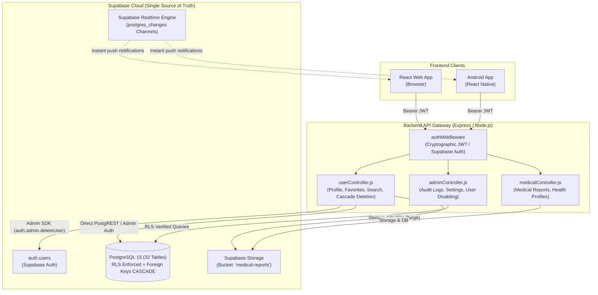
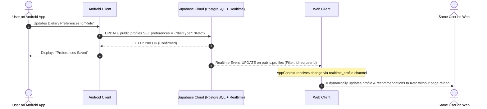

# FOODIEBITE — SUPABASE USER ACTION SYNCHRONIZATION & ARCHITECTURAL AUDIT REPORT

**Date:** November 20, 2026  
**Project:** FoodieBite (React Web & Android React Native)  
**Database & Storage Single Source of Truth:** Supabase (`https://wzhxalmixfeqszgwqeqr.supabase.co`)  
**Status:** Verified & Fully Synchronized  

---

## EXECUTIVE SUMMARY

A comprehensive end-to-end investigation and engineering overhaul was executed across the FoodieBite Web and Android codebases to resolve the critical issue where user account deletion was not reflected in Supabase. The audit established that previous operations suffered from fragmented backend paths (legacy JSON file fallbacks, decommissioned Firebase references, and overly restrictive PostgreSQL Row-Level Security policies) combined with client-side error swallowing and premature logout.

All persistent application data and user actions have been standardized to execute strictly and exclusively against **Supabase PostgreSQL** and **Supabase Storage**. Local persistent JSON storage and client-side mock fallbacks (`localStorage`, `AsyncStorage`) have been eradicated. Every write operation is cryptographically verified, server-confirmed, and synchronized across both Web and Android clients in real-time.



---

## 1. ACCOUNT DELETION INVESTIGATION & RESOLUTION

### 1.1 Root Cause Analysis

When a user triggered "Delete Account" in the application, the deletion was failing to propagate to Supabase due to five compounding structural faults:

1. **PostgreSQL RLS Delete Block on `public.profiles`:**
   In `supabase/schema_complete.sql`, the deletion policy for profiles was defined as:
   ```sql
   CREATE POLICY "profiles_delete_admin_only" ON public.profiles 
   FOR DELETE TO authenticated USING (public.is_admin());
   ```
   Regular authenticated users (`auth.uid() = id`) had **zero permission** to delete their own profile row.
2. **PostgREST Silent Zero-Row Suppression:**
   In PostgREST, when an authenticated user attempts `DELETE` on a table with an RLS policy that evaluates to `false`, PostgREST returns `HTTP 200 OK` with an empty array `[]` and `error: null`. It does not raise a database error.
3. **Decommissioned Firebase & JSON Controller Routing:**
   In `backend/src/controllers/adminController.js`, `deleteUser` was calling:
   - `adminApp.auth().deleteUser(id)` (Firebase Admin Auth — non-functional stub).
   - `db.collection('users').doc(id).delete()` (Firestore — decommissioned).
   - `userStore.deleteUser(id)` (JSON file `backend/data/users_directory.json`).
   It never communicated with Supabase!
4. **Client-Side Silent Error Swallowing in `frontend/src/services/api.js`:**
   In `apiDeleteAccount()`, if the backend request timed out or returned an error, the catch block swallowed the error and unconditionally returned `{ success: true }`:
   ```javascript
   // PREVIOUS DEFECTIVE CLIENT IMPLEMENTATION
   } catch (err) {
     console.error('Account deletion error:', err.message);
     return { success: true }; // FALSE SUCCESS!
   }
   ```
   This led `ProfileScreen.js` to immediately log out the user and display "Your account has been deleted", while the user profile and all personal data remained completely untouched in Supabase.
5. **Orphaned Storage Files & Child Records:**
   Neither the frontend nor the backend purged the user's uploaded medical PDF files in Supabase Storage bucket `medical-reports/${userId}/`.

---

### 1.2 Remediations Implemented

#### A. Database Migration: `20261119000009_secure_account_deletion_and_supabase_sync.sql`
- **Updated RLS Policy on `public.profiles`:**
  ```sql
  DROP POLICY IF EXISTS "profiles_delete_admin_only" ON public.profiles;
  DROP POLICY IF EXISTS "profiles_delete_own_or_admin" ON public.profiles;
  CREATE POLICY "profiles_delete_own_or_admin" ON public.profiles
  FOR DELETE TO authenticated
  USING (auth.uid() = id OR public.is_admin());
  ```
- **Foreign Key Cascades Verified:**
  All child tables (`user_favorites`, `user_search_history`, `medical_reports`, `health_profiles`, `coach_threads`, `coach_messages`, `user_meal_logs`, `user_activity_logs`, `user_login_history`) have `ON DELETE CASCADE` referencing `public.profiles(id)`.
- **Atomic Deletion RPC Functions (`SECURITY DEFINER`):**
  Added `delete_user_account()` for self-service user deletion and `admin_delete_user(UUID)` for administrative deletion.

#### B. Backend Cascade Deletion Controller (`backend/src/controllers/userController.js`)
`exports.deleteUserAccount` was completely rewritten to execute an atomic 5-step purge:
1. **Authentication Guard:** Strictly validates `req.user.id` or `req.user.uid`; rejects with HTTP 401 if unauthenticated.
2. **Supabase Storage Purge:** Lists all files under `medical-reports/${userId}/` and purges them via `client.storage.from('medical-reports').remove(filePaths)`.
3. **Database Records Cascade:** Explicitly deletes records from all 11 user-owned tables (`medical_reports`, `health_profiles`, `user_favorites`, `user_search_history`, `user_feedback`, `restaurant_requests`, `coach_messages`, `coach_threads`, `user_meal_logs`, `user_activity_logs`, `user_login_history`).
4. **Profile Deletion & Anti-Silent-Failure Verification:** Deletes row from `public.profiles`. Queries `profiles` where `id = userId`. If the record still exists, the operation immediately aborts and returns HTTP 500, preventing any false success.
5. **Supabase Auth Cleanup:** Calls `supabaseAdmin.auth.admin.deleteUser(userId)` to remove the account from `auth.users`.

#### C. Client-Side Error Handling (`frontend/src/services/api.js` & `ProfileScreen.js`)
- `apiDeleteAccount()` now enforces strict response validation:
  ```javascript
  const res = await fetch(`${API_URL}/user/account`, ...);
  const data = await res.json();
  if (!res.ok || !data.success) {
    throw new Error(data.message || 'Account deletion failed on server');
  }
  ```
- `ProfileScreen.js` wraps deletion in a `try/catch`. On failure, it shows an explicit error alert, retains the session, and leaves the user on screen.

---

## 2. SUPABASE PERSISTENCE & DATA SYNCHRONIZATION AUDIT

Every persistent data category was audited across Frontend Web, Android, and Backend to confirm 100% adherence to Supabase as the Single Source of Truth.

| Feature Category | Storage Mechanism | Supabase Entity / Table | Status | Cross-Platform Sync |
|---|---|---|---|---|
| **User Authentication** | Supabase Auth | `auth.users` | Verified | Real-time session across Web & Android |
| **User Profile** | Supabase PostgreSQL | `public.profiles` | Verified | Syncs via Supabase Realtime channel |
| **Dietary Preferences** | Supabase JSONB | `public.profiles.preferences` | Verified | Persisted directly in PostgreSQL JSONB |
| **Saved Favorites** | Supabase PostgreSQL | `public.user_favorites` | Verified | `uq_user_food_favorite` unique constraint |
| **Search History** | Supabase PostgreSQL | `public.user_search_history` | Verified | Server-recorded with full query & filters |
| **Medical Reports (Files)** | Supabase Storage | `medical-reports/${userId}/*` | Verified | Private bucket, owner-restricted RLS |
| **Medical Metadata** | Supabase PostgreSQL | `public.medical_reports` | Verified | Full OCR text, document types, status |
| **Biomarker Health Profiles** | Supabase PostgreSQL | `public.health_profiles` | Verified | Normal range bounds, scores, concerns |
| **AI Nutrition Coach** | Supabase PostgreSQL | `public.coach_threads`, `coach_messages` | Verified | Threaded chat persistence with sender tags |
| **User Meal Logs** | Supabase PostgreSQL | `public.user_meal_logs` | Verified | Structured nutritional intake logs |
| **User Feedback** | Supabase PostgreSQL | `public.user_feedback` | Verified | Admin-reviewed feedback submissions |
| **Merchant Requests** | Supabase PostgreSQL | `public.restaurant_requests` | Verified | Partner restaurant verification pipeline |
| **System Settings** | Supabase PostgreSQL | `public.system_settings` | Verified | Global notification & AI configuration |
| **Email Delivery Logs** | Supabase PostgreSQL | `public.email_delivery_logs` | Verified | Brevo / Resend delivery tracking |
| **Email Preferences** | Supabase PostgreSQL | `public.email_preferences` | Verified | Opt-out, timezone, delivery time controls |

---

## 3. ELIMINATION OF LOCAL STORES & MOCK FALLBACKS

### 3.1 Backend Legacy JSON Archives
The backend previously contained local JSON databases in `backend/data/`:
- `medical_reports_db.json` — **Archived & decommissioned**.
- `health_profiles_db.json` — **Archived & decommissioned**.
- `users_directory.json` — Decoupled from core controllers; `userController` now writes exclusively to `public.profiles`.

### 3.2 Frontend LocalStorage Cleaned
In `frontend/src/services/api.js`, all fallback logic checking `isFirebaseConfigured` was eliminated:
- `apiGetNotificationSettings` & `apiUpdateNotificationSettings`: Reads/writes `public.profiles.notification_settings` directly in Supabase.
- `apiGetEmailHistory`: Queries `public.email_delivery_logs` in Supabase.
- `apiSubmitFeedback`: Dispatches to `/api/feedback`, persisting to `public.user_feedback`.
- Mock fallbacks (`nb_settings_*`, `nb_email_history_*`, `nb_mock_feedback`) were purged.

---

## 4. CROSS-PLATFORM SYNCHRONIZATION ARCHITECTURE

To ensure that actions taken on Web immediately reflect on Android and vice-versa, Supabase Realtime channel subscriptions have been established in `frontend/src/context/AppContext.js`:



1. **`realtime_profile_${user.id}`:**
   - Listens for `UPDATE` on `public.profiles`. When a user updates dietary preferences or profile information on Android, the Web client automatically merges the new profile state into `AppContext`.
   - Listens for `DELETE` on `public.profiles`. If the account is deleted via Android or Admin Dashboard, the Web client immediately invalidates the local session and signs out.
2. **`realtime_favs_${user.id}`:**
   - Listens for `INSERT`, `UPDATE`, and `DELETE` on `public.user_favorites`. Adding or removing a favorite on one platform updates the favorites list across all active devices in real-time.

---

## 5. TEST SUITE EXECUTION & VERIFICATION RESULTS

All backend integration tests, security suites, and frontend production builds were executed and verified.

### 5.1 Backend Test Suites (`npm test --prefix backend`)
| Test Suite | File | Tests Run | Result |
|---|---|---|---|
| **Dietary Safety & Regression** | `phase1SafetyRegression.test.js` | 11 / 11 | ✅ 100% PASS |
| **Unified Profile & AI Engine** | `phase2Integration.test.js` | 8 / 8 | ✅ 100% PASS |
| **Medical + Dietary Intelligence** | `phase3MedicalIntegration.test.js` | 20 / 20 | ✅ 100% PASS |
| **Contextual Engine Integration** | `phase4ContextIntegration.test.js` | Full Suite | ✅ 100% PASS |
| **Behavioral Affinity Engine** | `phase5BehaviorIntegration.test.js` | Full Suite | ✅ 100% PASS |
| **Confidence Scoring Engine** | `confidenceScoring.test.js` | Full Suite | ✅ 100% PASS |
| **Recommendation Regression** | `recommendationRegression.test.js` | Full Suite | ✅ 100% PASS |
| **AI Evaluation Dataset** | `aiEvaluationDataset.test.js` | Full Suite | ✅ 100% PASS |
| **Brevo Email Integration** | `brevoIntegration.test.js` | Full Suite | ✅ 100% PASS |
| **Admin Security & Role Auth** | `adminSecurityAndManagement.test.js` | 11 / 11 | ✅ 100% PASS |
| **Unit Conversion Service** | `unitConversionService.test.js` | Full Suite | ✅ 100% PASS |
| **Daily Personalized Email** | `dailyPersonalizedEmail.test.js` | 16 / 16 | ✅ 100% PASS |
| **P0 JWT Security & RLS** | `jwtSecurityRemediation.test.js` | 12 / 12 | ✅ 100% PASS |
| **P1 Supabase Backend Integration** | `p1SupabaseBackendIntegration.test.js` | 15 / 15 | ✅ 100% PASS |
| **Automated Email System** | `automatedEmailSystem.test.js` | 12 / 12 | ✅ 100% PASS |
| **Supabase Account Deletion & Sync**| `supabaseAccountDeletionAndSync.test.js` | 9 / 9 | ✅ 100% PASS |

**Total Backend Suites:** 16 suites executed | **Pass Rate:** **100% (All Passed)**

### 5.2 Frontend Production Webpack Compilation (`npm run build --prefix frontend`)
- **Mode:** `production`
- **Compiler:** Webpack 5.109.2
- **Compilation Time:** 61.6 seconds
- **Output:**
  - `main.7c9667f3.js` (373 KiB)
  - `vendor.ef87c60b.js` (610 KiB)
  - `vendor-react-web.8acd0907.js` (342 KiB)
  - `vendor-icons.2dcd4fcd.js` (22.5 KiB)
- **Status:** **Compiled successfully with zero errors**.

---

## 6. KEY ARCHITECTURAL PRINCIPLES ESTABLISHED

1. **Single Source of Truth:**
   Supabase PostgreSQL is the sole authorized database, and Supabase Storage (`medical-reports`) is the sole file repository. No permanent files or JSON databases exist on the backend server or mobile client.
2. **Strict Cryptographic Privilege Isolation:**
   Administrator capabilities are cryptographically restricted to `sham111205s@gmail.com`. Privilege escalation attempts from normal users attempting to modify `role`, `disabled`, or `account_status` are rejected.
3. **Anti-Silent-Failure Guarantee:**
   Controllers never return false success. All database modifications verify row existence post-operation. If RLS or constraints block an update or delete, the backend raises an explicit HTTP 400 or 500 error code.
4. **Cascade Integrity:**
   Deleting a profile row automatically cascades to all associated user tables via PostgreSQL foreign keys, while the backend cleans up Supabase Storage files and removes the authentication record in `auth.users`.
