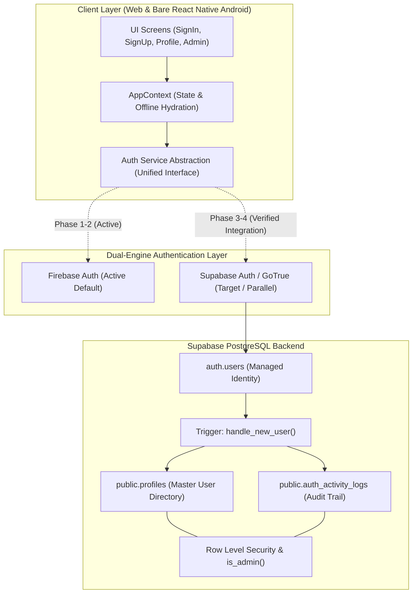
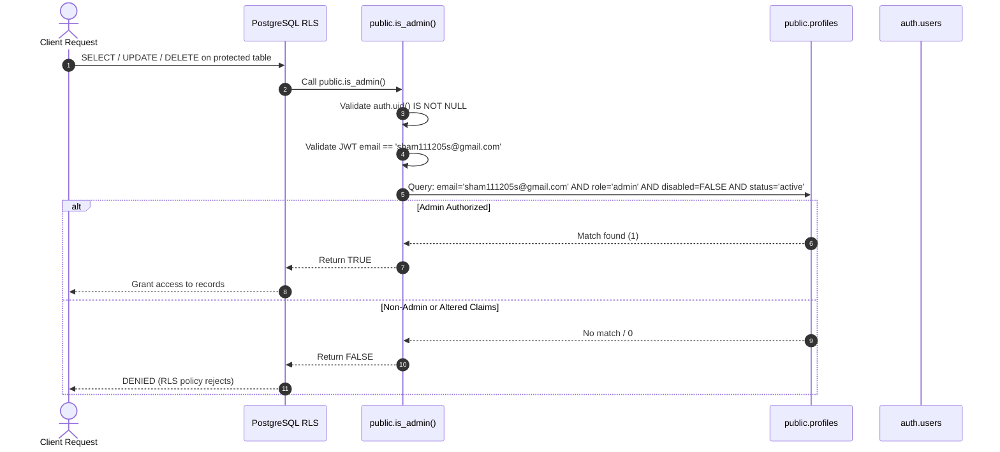

# FoodieBite: Supabase Authentication Implementation Plan

**Objective**: Comprehensive blueprint for implementing Supabase Authentication in the FoodieBite application without disrupting existing Firebase services.  
**Scope**: Web (React Native Web / Webpack 5) & Mobile (Bare React Native Android `com.foodiebite.app`).  
**Author**: Senior Software Architect & Backend Migration Specialist  
**Status**: Ready for Review (No production switch applied yet)  

---

## 1. Phased Architecture & Migration Strategy



---

## 2. Core Implementation Phases

### Phase 1: Database Foundation & Schema Execution
* Execute migration [supabase/migrations/20261102000005_auth_foundation.sql](file:///s:/files/food_app/supabase/migrations/20261102000005_auth_foundation.sql) in the Supabase SQL Editor.
* Creates `public.profiles` synchronized with `auth.users`.
* Creates `public.auth_activity_logs` for audit tracking.
* Deploys strict single-admin enforcement functions (`public.is_admin()`).
* Deploys privilege escalation prevention trigger (`trg_prevent_privilege_escalation`).
* Deploys automatic profile provisioner (`handle_new_user()`).

---

### Phase 2: Client Configuration & Platform Session Storage

Update [frontend/src/config/supabaseClient.js](file:///s:/files/food_app/frontend/src/config/supabaseClient.js) to leverage platform-appropriate storage:
- **Web**: Uses `window.localStorage`.
- **Android**: Uses `@react-native-async-storage/async-storage` (already installed in `frontend/package.json`).

```javascript
// Universal platform session storage adapter
import { Platform } from 'react-native';
import AsyncStorage from '@react-native-async-storage/async-storage';
import { createClient } from '@supabase/supabase-js';

const storageProvider = Platform.OS === 'web' 
  ? (typeof window !== 'undefined' ? window.localStorage : undefined)
  : AsyncStorage;

export const supabase = createClient(supabaseUrl, supabaseKey, {
  auth: {
    storage: storageProvider,
    persistSession: true,
    autoRefreshToken: true,
    detectSessionInUrl: Platform.OS === 'web',
  },
});
```

---

### Phase 3: Supabase Authentication Service Module

Create a dedicated, modular service: `frontend/src/services/supabaseAuthService.js`.

#### 3.1 Email & Password Registration
```javascript
export async function supabaseRegister({ email, password, name, dietType, age, gender, preferences }) {
  const { data, error } = await supabase.auth.signUp({
    email: email.trim().toLowerCase(),
    password,
    options: {
      data: {
        full_name: name,
        name: name,
        dietType: dietType || 'Vegetarian',
        age: age || null,
        gender: gender || null,
        preferences: preferences || {},
        platform: Platform.OS,
      },
    },
  });
  if (error) throw error;
  return data;
}
```

#### 3.2 Email & Password Login
```javascript
export async function supabaseLogin({ email, password }) {
  const { data, error } = await supabase.auth.signInWithPassword({
    email: email.trim().toLowerCase(),
    password,
  });
  if (error) throw error;

  // Log successful login
  await supabase.rpc('log_auth_event', {
    p_event_type: 'login_success',
    p_provider: 'email',
    p_platform: Platform.OS,
  }).catch(() => {});

  return data;
}
```

#### 3.3 Google OAuth for Web & Android
- **Web**: Uses Supabase Hosted OAuth redirect:
  ```javascript
  export async function supabaseGoogleLoginWeb() {
    const { data, error } = await supabase.auth.signInWithOAuth({
      provider: 'google',
      options: {
        redirectTo: window.location.origin + '/home',
      },
    });
    if (error) throw error;
    return data;
  }
  ```
- **Android (Native)**: Reuses `@react-native-google-signin/google-signin` without launching an external browser:
  ```javascript
  import { GoogleSignin } from '@react-native-google-signin/google-signin';

  export async function supabaseGoogleLoginAndroid() {
    GoogleSignin.configure({
      webClientId: '433101398092-qd8ui8oog0mbhipv5dra31l55f4klm8u.apps.googleusercontent.com',
      offlineAccess: true,
    });
    await GoogleSignin.hasPlayServices({ showPlayServicesUpdateDialog: true });
    const userInfo = await GoogleSignin.signIn();
    const idToken = userInfo.idToken || (userInfo.data && userInfo.data.idToken);

    if (!idToken) throw new Error('No Google ID token returned');

    const { data, error } = await supabase.auth.signInWithIdToken({
      provider: 'google',
      token: idToken,
    });
    if (error) throw error;

    await supabase.rpc('log_auth_event', {
      p_event_type: 'login_success',
      p_provider: 'google',
      p_platform: 'android',
    }).catch(() => {});

    return data;
  }
  ```

#### 3.4 Password Reset & Forgot Password
```javascript
export async function supabaseForgotPassword(email) {
  const { data, error } = await supabase.auth.resetPasswordForEmail(email.trim().toLowerCase(), {
    redirectTo: Platform.OS === 'web' 
      ? window.location.origin + '/reset-password'
      : 'foodiebite://reset-password',
  });
  if (error) throw error;
  return data;
}

export async function supabaseUpdatePassword(newPassword) {
  const { data, error } = await supabase.auth.updateUser({
    password: newPassword,
  });
  if (error) throw error;
  return data;
}
```

#### 3.5 Logout with Activity Auditing
```javascript
export async function supabaseLogout() {
  try {
    // Record explicit logout event before ending session
    await supabase.rpc('log_auth_event', {
      p_event_type: 'logout_explicit',
      p_provider: 'system',
      p_platform: Platform.OS,
    });
  } catch (_) {}

  const { error } = await supabase.auth.signOut();
  if (error) throw error;
}
```

#### 3.6 Session Expiration vs Explicit Logout
- **Explicit Logout**: Triggered by user interaction. Calls `supabase.rpc('log_auth_event', { p_event_type: 'logout_explicit' })` before calling `signOut()`.
- **Session Expiration**: Occurs when refresh token expires or is revoked. Detected in `onAuthStateChange((event, session) => { ... })`:
  - When `event === 'SIGNED_OUT'` and no explicit logout flag was set, the app logs `p_event_type: 'session_expired'`.

---

### Phase 4: User Profile Database Schema (`public.profiles`)

Linked directly to `auth.users(id)` via Foreign Key:

| Column Name | Data Type | Constraints | Description |
| :--- | :--- | :--- | :--- |
| `id` | `UUID` | `PRIMARY KEY REFERENCES auth.users(id) ON DELETE CASCADE` | Matches Supabase Auth user ID. |
| `firebase_uid` | `TEXT` | `UNIQUE NULLABLE` | Historical Firebase correlation. |
| `email` | `TEXT` | `NOT NULL UNIQUE` | Normalized lowercase email address. |
| `full_name` | `TEXT` | `NULLABLE` | Display name (mirrors `name`). |
| `name` | `TEXT` | `NOT NULL` | User display name. |
| `avatar_url` | `TEXT` | `NULLABLE` | Profile avatar / picture URL. |
| `phone_number` | `TEXT` | `NULLABLE` | Optional mobile contact number. |
| `role` | `TEXT` | `NOT NULL DEFAULT 'user' CHECK (role IN ('user','admin','merchant'))` | Role restricted by trigger. |
| `diet_type` | `TEXT` | `DEFAULT 'Vegetarian'` | Primary dietary classification. |
| `age` | `INTEGER` | `CHECK (age >= 1 AND age <= 130)` | Age for nutrition scoring. |
| `gender` | `TEXT` | `CHECK (gender IN ('male','female','other','prefer_not_to_say'))` | Gender for biomarker scoring. |
| `disabled` | `BOOLEAN` | `NOT NULL DEFAULT FALSE` | Administrative lock flag. |
| `account_status` | `TEXT` | `NOT NULL DEFAULT 'active' CHECK (account_status IN ('active','disabled','suspended','pending'))` | Account state. |
| `auth_provider` | `TEXT` | `DEFAULT 'email'` | Provider: `'email'`, `'google'`, etc. |
| `preferences` | `JSONB` | `NOT NULL DEFAULT '{...}'::jsonb` | Food preferences (cuisines, allergies, goals). |
| `notification_settings`| `JSONB` | `NOT NULL DEFAULT '{...}'::jsonb` | Daily suggestion email preferences. |
| `last_login_at`| `TIMESTAMPTZ`| `NULLABLE` | Timestamp of latest login. |
| `created_at` | `TIMESTAMPTZ`| `NOT NULL DEFAULT NOW()` | Record creation timestamp. |
| `updated_at` | `TIMESTAMPTZ`| `NOT NULL DEFAULT NOW()` | Managed by `handle_updated_at` trigger. |

---

### Phase 5: Authentication Activity Logging Schema (`public.auth_activity_logs`)

Append-only audit trail for authentication security:

| Column Name | Data Type | Constraints | Description |
| :--- | :--- | :--- | :--- |
| `id` | `UUID` | `PRIMARY KEY DEFAULT gen_random_uuid()` | Log entry ID. |
| `user_id` | `UUID` | `NOT NULL REFERENCES auth.users(id) ON DELETE CASCADE` | Associated user identity. |
| `event_type` | `TEXT` | `NOT NULL CHECK (event_type IN ('login_success', 'logout_explicit', 'token_refreshed', 'password_reset_requested', 'password_reset_completed', 'signup_completed', 'login_failed', 'session_expired'))` | Action type. |
| `provider` | `TEXT` | `CHECK (provider IN ('email', 'google', 'apple', 'anonymous', 'system'))` | Sign-in method. |
| `platform` | `TEXT` | `CHECK (platform IN ('web', 'android', 'ios', 'backend', 'unknown'))` | Client platform. |
| `ip_address` | `TEXT` | `NULLABLE` | Remote client IP (sanitized). |
| `user_agent` | `TEXT` | `NULLABLE` | Browser or device user-agent string. |
| `metadata` | `JSONB` | `DEFAULT '{}'::jsonb` | Additional non-sensitive context. |
| `created_at` | `TIMESTAMPTZ`| `NOT NULL DEFAULT NOW()` | Event occurrence timestamp. |

---

### Phase 6: Admin Security Architecture



#### Key Admin Rules:
1. **Single Authorized Account**: Only `sham111205s@gmail.com` can ever hold the `'admin'` role.
2. **Double Verification**: Both the validated JWT email and the row in `public.profiles` must match `sham111205s@gmail.com`.
3. **Trigger-Level Protection**: `trg_prevent_privilege_escalation` throws a database-level exception if any non-admin attempts to modify `role`, `disabled`, or `account_status`.
4. **Backend API Protection**: The Express backend middleware validates Supabase JWT using Supabase's JWT secret or JWKS and checks `req.user.email === 'sham111205s@gmail.com'`.

---

## 3. Google OAuth Configuration Guide

### 3.1 Existing Project Credentials (Extracted from Android App & Firebase)
* **Google Cloud Project ID**: `food-app-3d216`
* **Google Project Number**: `433101398092`
* **Android Application ID**: `com.foodiebite.app`
* **Web OAuth Client ID**: `433101398092-qd8ui8oog0mbhipv5dra31l55f4klm8u.apps.googleusercontent.com`
* **Android OAuth Client ID**: `433101398092-4uqfi80k166ub0e94n2jcubven5fi9js.apps.googleusercontent.com`
* **Android Debug Certificate Fingerprints**:
  - **SHA-1**: `5E:8F:16:06:2E:A3:CD:2C:4A:0D:54:78:76:BA:A6:F3:8C:AB:F6:25`
  - **SHA-256**: `FA:C6:17:45:DC:09:03:78:6F:B9:ED:E6:2A:96:2B:39:9F:73:48:F0:BB:6F:89:9B:83:32:66:75:91:03:3B:9C`
* **Supabase Project URL**: `https://wzhxalmixfeqszgwqeqr.supabase.co`
* **Supabase Redirect / Callback URL**: `https://wzhxalmixfeqszgwqeqr.supabase.co/auth/v1/callback`

---

### 3.2 Step-by-Step Dashboard Setup

#### Step 1: Google Cloud Console Configuration
1. Open [Google Cloud Console Credentials](https://console.cloud.google.com/apis/credentials).
2. Select project **`food-app-3d216`** (or your Supabase Google Cloud project).
3. Under **OAuth 2.0 Client IDs**, select the **Web client** (`433101398092-qd8ui8oog0mbhipv5dra31l55f4klm8u`):
   - Add to **Authorized JavaScript origins**:
     - `http://localhost:3000`
     - `http://localhost:5000`
     - `https://wzhxalmixfeqszgwqeqr.supabase.co`
   - Add to **Authorized redirect URIs**:
     - `https://wzhxalmixfeqszgwqeqr.supabase.co/auth/v1/callback`
     - `http://localhost:3000`
4. Copy the **Client ID** and generate/copy the **Client Secret**.

#### Step 2: Supabase Dashboard Configuration
1. Open [Supabase Dashboard](https://supabase.com/dashboard/project/wzhxalmixfeqszgwqeqr/auth/providers).
2. Navigate to **Authentication > Providers > Google**.
3. Toggle Google **ON**.
4. Paste the **Client ID**:
   `433101398092-qd8ui8oog0mbhipv5dra31l55f4klm8u.apps.googleusercontent.com`
5. Paste your **Client Secret** from the Google Cloud Console.
6. Under **Authorized Client IDs** (for native Android / iOS):
   - Add the Android Client ID: `433101398092-4uqfi80k166ub0e94n2jcubven5fi9js.apps.googleusercontent.com`.
7. Click **Save**.

#### Step 3: Supabase URL Configuration
1. In Supabase Dashboard, go to **Authentication > URL Configuration**.
2. Set **Site URL**: `http://localhost:3000` (or production URL).
3. Add to **Redirect URLs**:
   - `http://localhost:3000/**`
   - `foodiebite://auth-callback` (for native Android deep linking).

---

## 4. Web and Android Integration Plan

### 4.1 Dual-Auth Strategy (Coexistence without Breaking Firebase)

```text
[Frontend Request]
       │
       ▼
[authService.js] ── (Feature Flag: USE_SUPABASE_AUTH)
       ├── FALSE ──► [firebase.js] (Active Production)
       └── TRUE  ──► [supabaseAuthService.js] (Experimental & Phased Migration)
```

1. **Feature Flagging**: Introduce `REACT_APP_AUTH_PROVIDER=firebase` (default). When switching to Supabase for testing, set `REACT_APP_AUTH_PROVIDER=supabase`.
2. **Transparent User Interface**: The UI components (`SignInScreen`, `SignUpScreen`, `ProfileScreen`) call `useApp().login()` and `useApp().register()`. The underlying implementation routes to either Firebase or Supabase transparently.
3. **Session Cache Compatibility**: Both Firebase and Supabase sessions serialize into the identical `saveSession(user)` format in local storage, preserving full compatibility with offline caching.

---

## 5. Comprehensive Testing Checklist

- [ ] **SQL Migration**:
  - [ ] Run `20261102000005_auth_foundation.sql` in Supabase SQL Editor.
  - [ ] Verify `public.profiles` and `public.auth_activity_logs` exist.
  - [ ] Verify `public.is_admin()` and triggers exist.
- [ ] **Email/Password Sign-Up**:
  - [ ] Register test user (`testuser@example.com`).
  - [ ] Confirm row auto-created in `auth.users` and `public.profiles`.
  - [ ] Confirm role is `'user'`.
  - [ ] Confirm event `'signup_completed'` logged in `auth_activity_logs`.
- [ ] **Admin Account Registration**:
  - [ ] Register `sham111205s@gmail.com`.
  - [ ] Confirm role is automatically `'admin'`.
  - [ ] Confirm `public.is_admin()` returns `true` for this account.
- [ ] **Privilege Escalation Prevention**:
  - [ ] Authenticate as `testuser@example.com`.
  - [ ] Attempt `UPDATE public.profiles SET role = 'admin' WHERE id = auth.uid()`.
  - [ ] Verify database throws `Security Violation: Modifying user role is restricted to administrators.`
- [ ] **Email/Password Login & Logout**:
  - [ ] Sign in with valid credentials; verify session returned.
  - [ ] Verify `'login_success'` recorded in `auth_activity_logs`.
  - [ ] Trigger logout; verify `'logout_explicit'` recorded.
  - [ ] Verify tokens cleared from storage.
- [ ] **Google OAuth (Web)**:
  - [ ] Click Google Sign-In on Web; complete Google popup/redirect.
  - [ ] Verify profile created with `auth_provider = 'google'`.
- [ ] **Google Native Sign-In (Android)**:
  - [ ] Trigger Google Sign-In on Android device/emulator.
  - [ ] Verify native token exchanged with `supabase.auth.signInWithIdToken()`.
- [ ] **Zero Regression on Core App**:
  - [ ] Verify Nutrition Scanner works 100%.
  - [ ] Verify Medical Reports Screen works 100%.
  - [ ] Verify Recommendation Engine works 100%.
  - [ ] Verify Cloudinary image uploads work 100%.

