# FOODIEBITE — COMPREHENSIVE BACKEND INVENTORY REPORT

**Project:** FoodieBite Core Backend & API Gateway  
**Assessment Date:** November 25, 2026  
**Auditor:** Senior Application Security, QA Automation & DevSecOps Engineering Team  
**Evaluation Target:** Academic & Enterprise Backend Security Audit  

---

## 1. TECHNOLOGY STACK

| Component | Technology | Specification / Version |
|---|---|---|
| **Runtime Environment** | Node.js | v22.18.0 LTS (V8 JavaScript Engine) |
| **Language** | JavaScript | ECMAScript 2022+ (ES6 Modules & CommonJS) |
| **Web Framework** | Express.js | v4.19.2 (Layered REST Application) |
| **Local AI Engine** | Ollama Engine | `qwen2.5:0.5b` via Local HTTP Daemon (Port 11434) |
| **Package Manager** | npm | v10.x |
| **Cloud Database & Storage** | Supabase Platform | PostgreSQL 15.6 + Supabase Storage API |
| **OCR & Document Engine** | Tesseract.js / pdf-parse | In-Memory Raster Processing (Zero Disk Footprint) |
| **Email Delivery Pipeline** | Dual-Provider Gateway | Primary: Resend HTTPS API; Fallback: Brevo v3 / SMTP |
| **Hosting & Deployment** | Node.js Process / Docker | Reverse Proxy (Nginx / Cloudflare compatible) |

---

## 2. ARCHITECTURAL CLASSIFICATION

FoodieBite follows a **Decoupled Layered Monolith Architecture** with clean boundary separation:

```mermaid
flowchart TD
    subgraph ClientLayer["Presentation & Client Layer"]
        WEB["React Web Client<br/>(Webpack / SPA)"]
        MOB["React Native Android<br/>(APK / Native)"]
    end

    subgraph GatewayLayer["API Gateway & Middleware Layer (Express)"]
        SEC["Security Middlewares<br/>(Helmet, CORS, RateLimit)"]
        AUTH["authMiddleware<br/>(Cryptographic JWT / Supabase Auth)"]
        LOG["Observability<br/>(Request Correlation, Morgan)"]
    end

    subgraph ControllerLayer["Application Controllers Layer"]
        C_AUTH["authController"]
        C_USER["userController"]
        C_MED["medicalController"]
        C_AMED["adminMedicalReportController"]
        C_FOOD["foodController"]
        C_COACH["coachController / ollamaHealthCoach"]
        C_ADMIN["adminController"]
        C_EMAIL["emailController"]
    end

    subgraph ServiceLayer["Domain & Intelligence Services Layer"]
        S_REC["recommendationEngine<br/>(Dietary + Medical)"]
        S_DOC["documentProcessorService<br/>(In-Memory OCR)"]
        S_AI["ollamaHealthCoach<br/>(Local AI: qwen2.5:0.5b)"]
        S_MAIL["emailAutomationService<br/>(Resend / Brevo Fallback)"]
        S_CRON["emailScheduler<br/>(node-cron Timezone Engine)"]
    end

    subgraph DataLayer["Persistence & Storage Single Source of Truth"]
        DB[("Supabase PostgreSQL 15<br/>32 Public Tables + RLS")]
        STORE["Supabase Storage<br/>Bucket: 'medical-reports' (Private)"]
        CACHE["In-Memory LRU Cache<br/>(OpenFoodFacts / Products / Recs)"]
    end

    ClientLayer --> SEC
    SEC --> AUTH
    AUTH --> LOG
    LOG --> ControllerLayer
    ControllerLayer --> ServiceLayer
    ServiceLayer --> DataLayer
```

### Architectural Characteristics:
1. **Separation of Concerns:** Route definitions in `routes/` delegate strictly to `controllers/`, which invoke domain business logic in `services/`, persisting exclusively via `config/supabase.js`.
2. **Stateless Compute:** Backend servers maintain zero persistent state on local disk. Uploads are streamed to memory (`multer.memoryStorage`) and forwarded directly to Supabase Storage.
3. **Resilient Transactional Pipeline:** Email delivery leverages a dual-provider fallback engine (Primary: Resend HTTPS API; Secondary: Brevo REST API v3 / SMTP).
4. **Local Sovereign AI Intelligence:** Clinical nutrition consultations and medical health summaries run locally on private hardware via Ollama (`qwen2.5:0.5b`), guaranteeing patient privacy and eliminating external third-party API exposure.

---

## 3. API STRUCTURE & PROTOCOLS

- **API Style:** RESTful HTTP/1.1 & HTTP/2 with JSON payloads (`application/json`) and multipart form data (`multipart/form-data`) for document uploads.
- **Total Discovered Routes:** **141 endpoints** across 12 feature modules:
  1. Authentication & Identity (`/api/auth/*` — 14 endpoints)
  2. User Profiles & Gamification (`/api/user/*` — 16 endpoints)
  3. Medical Intelligence & OCR (`/api/medical/*` — 10 endpoints)
  4. Admin Medical Management (`/api/admin/users/:userId/medical-reports/*` — 8 endpoints)
  5. Food Catalog & Recommendations (`/api/food/*` — 17 endpoints)
  6. Admin Food Database Management (`/api/admin/foods/*` — 6 endpoints)
  7. AI Health Coach & Ollama Assistant (`/api/coach/*` — 8 endpoints)
  8. Administration & User Auditing (`/api/admin/*` — 23 endpoints)
  9. Merchant & Restaurant Partner Lifecycle (`/api/merchant/*`, `/api/restaurants/*` — 16 endpoints)
  10. Nearby Location Services (`/api/nearby/*` — 5 endpoints)
  11. Email Automation & Unsubscribes (`/api/email/*` — 12 endpoints)
  12. System Telemetry & Health Checks (`/health`, `/ready`, `/api/debug/*` — 6 endpoints)
- **Real-Time Push Communications:** Supabase Realtime Channels (`postgres_changes` via WebSockets) powering cross-platform state synchronization between React Web and Android.
- **Deep Linking & Discovery:** External food delivery integration via MealMe URL builder and OpenFoodFacts barcode resolution proxy.

---

## 4. AUTHENTICATION MECHANISMS

FoodieBite implements a **Dual-Verification Cryptographic Authentication Engine**:

1. **Supabase Access Tokens (Primary):**
   - Issued by Supabase Auth (`https://wzhxalmixfeqszgwqeqr.supabase.co/auth/v1`).
   - Cryptographically verified in `authMiddleware.js` via the official Supabase Auth `/auth/v1/user` endpoint or HMAC-SHA256 signature against `SUPABASE_JWT_SECRET`.
   - Populates PostgreSQL `auth.uid()` during PostgREST operations to strictly enforce Row-Level Security (RLS).
2. **Backend Application Tokens (Secondary):**
   - Signed using `jsonwebtoken` (HS256) with a 7-day expiration (`JWT_EXPIRE`).
   - Strict signature and expiration validation in `verifyLocalToken()`.
3. **OAuth2 Authentication:**
   - Native Google Sign-In on Android (`@react-native-google-signin/google-signin`) and Google Identity Services on Web.
   - IdTokens are validated and exchanged via Supabase Auth.
4. **Zero-Trust Hardening:**
   - Unsigned base64 payloads and `alg: none` are strictly rejected.
   - Disabled and suspended accounts are blocked at the middleware gateway (`HTTP 403 Forbidden`).

---

## 5. AUTHORIZATION & ACCESS CONTROL

- **Role-Based Access Control (RBAC):**
  - Roles: `user` (default), `merchant`, `admin`.
  - **Sole Administrator Isolation:** Administrative privileges are cryptographically restricted to designated email address `sham111205s@gmail.com`. Privilege escalation attempts from normal users are blocked by database triggers (`prevent_profile_privilege_escalation`).
  - **Admin Medical Governance:** Dedicated administrative routes (`/api/admin/users/:userId/medical-reports`) enforce strict role validation (`requireAdmin`), allowing authorized administrators to review clinical summaries and view original scanned reports while preventing unauthorized horizontal privilege escalation between ordinary users.
- **PostgreSQL Row-Level Security (RLS):**
  - RLS is explicitly enabled on all **32 public database tables**.
  - Policies enforce that authenticated users can only query, update, or delete rows where `auth.uid() = id` or `auth.uid() = user_id`.
  - Storage bucket `medical-reports` enforces path isolation: users can only access files within `{userId}/*`.

---

## 6. DATABASE ARCHITECTURE

- **Engine:** Supabase PostgreSQL 15.6.
- **Single Source of Truth:** All local JSON databases (`medical_reports_db.json`, `health_profiles_db.json`) have been archived and decoupled.
- **Schema Overview (32 Core Tables):**
  - `profiles`: Core identity, dietary preferences, and settings.
  - `medical_reports`: Extracted OCR, metadata, and storage file references.
  - `health_profiles`: Computed biomarker scores, clinical concerns, and normal ranges.
  - `user_favorites`: User-saved food and recipe bookmarks (`uq_user_food_favorite`).
  - `user_search_history`: Search queries, applied filters, and result counts.
  - `user_meal_logs`: Nutritional intake logs and calorie tracking.
  - `user_deficiencies`: Personalized nutrient deficiency tracking.
  - `user_gamification`: Points, streaks, and engagement badges.
  - `user_feedback`: User bug reports and feature requests.
  - `restaurant_requests`: Partner restaurant onboarding applications.
  - `approved_restaurants`: Verified merchant restaurants for public discovery.
  - `cached_foods`: Offline OpenFoodFacts cache.
  - `coach_threads` & `coach_messages`: AI Nutritionist conversation logs.
  - `email_campaigns` & `email_campaign_recipients`: Broadcast campaign tracking.
  - `email_delivery_logs`: Transactional and scheduled email audit trail.
  - `email_preferences`: Opt-out, timezone, and delivery window settings.
  - `email_unsubscribes`: RFC 8058 one-click unsubscribe records.
  - `admin_audit_logs`: Immutable audit logs for all administrative interventions.
  - `system_settings`: Global application and notification configurations.
  - `analytics_events` & `feature_daily_aggregates`: Anonymized telemetry.

---

## 7. OBSERVABILITY & SECURITY CONTROLS

1. **Security Headers & CORS:**
   - `helmet` with `crossOriginResourcePolicy: { policy: 'cross-origin' }`.
   - `cors` with dynamic origin whitelist checking (`CLIENT_URL`, `http://localhost:3000`).
2. **Rate Limiting:**
   - `/api/auth`: 20 requests per 15 minutes.
   - `/api/food/search`: 30 requests per minute.
   - `/api/coach`: Configurable rate limit (default 60 requests/min).
   - `/api/nearby`: 60 requests per minute.
3. **Scheduled Automations:**
   - Hourly cron job evaluating local user timezones to deliver personalized 9:00 AM breakfast, lunch, and dinner digests.
4. **Document Processing & OCR:**
   - In-memory OCR extraction using Tesseract.js / regex parsing, extracting fasting glucose, total cholesterol, HbA1c, and vitamin D with zero disk storage footprint.
