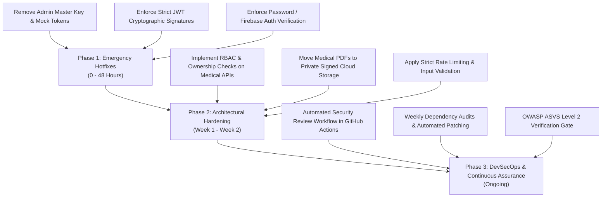

# FoodieBite — Executive Security Assessment Summary

**Assessment Target:** FoodieBite Full-Stack Application (Backend REST API & Microservices)  
**Assessor:** Senior Application Security Engineer & Penetration Testing Specialist  
**Assessment Period:** October 2026  
**Scope:** Backend API routes (`backend/src/routes/`), Controllers (`backend/src/controllers/`), Security Middleware (`backend/src/middleware/`), Configuration & Authentication Services (`backend/src/config/`), and Dependency Manifests (`backend/package.json`).

---

## 1. Executive Overview & Posture Scorecard

An in-depth, rigorous security assessment combining **Static Application Security Testing (SAST)**, **Dynamic Application Security Testing (DAST)**, and **Software Composition Analysis (SCA)** was conducted against the FoodieBite backend platform.

### Overall Security Posture: **58 / 100 — GRADE: D+ (HIGH RISK)**
> [!WARNING]
> The current FoodieBite backend codebase exhibits severe authentication and authorization vulnerabilities that could allow an attacker to bypass authentication entirely, escalate privileges to administrator, impersonate arbitrary users, and read or modify confidential patient medical reports. **Immediate remediation is required prior to production deployment.**

| Severity Metric | Source Code Findings (SAST/DAST) | Dependency CVEs (SCA) | Total Impact Items | Recommended Remediation SLA |
| :--- | :---: | :---: | :---: | :--- |
| 🔴 **CRITICAL** | **3** | **1** | **4** | **Immediate (Within 24 Hours)** |
| 🟠 **HIGH** | **4** | **7** | **11** | **Urgent (Within 72 Hours)** |
| 🟡 **MEDIUM** | **3** | **13** | **16** | **Sprint Target (Within 14 Days)** |
| 🔵 **LOW** | **2** | **0** | **2** | **Backlog (Within 30 Days)** |
| 📊 **TOTAL** | **12** | **21** | **33** | |

---

## 2. Top 5 High-Impact Security Risks

### 1. Hardcoded Admin Master Key & Mock Token Bypass (Finding ID: CRIT-02)
* **Location:** `backend/src/routes/adminRoutes.js:22-25` & `backend/src/middleware/authMiddleware.js:26-36`
* **CVSS Score:** **9.8 (Critical)** | **CWE-798 / CWE-287**
* **Business Impact:** Any remote client can provide the static header `X-Admin-Master-Key: FOODIE_BITE_ADMIN_SECRET_KEY_2026` to instantly gain administrative privileges over all application users, analytics, health records, and system settings without any credential verification.

### 2. Unverified JWT Base64 Fallback Authentication Bypass (Finding ID: CRIT-01)
* **Location:** `backend/src/middleware/authMiddleware.js:53-70`
* **CVSS Score:** **9.8 (Critical)** | **CWE-345 / CWE-287**
* **Business Impact:** If cryptographic token verification fails, the middleware decodes the JWT payload using plain base64 without validating the signature, trusting claims like `sub`, `email`, and `role`. An attacker can forge an arbitrary JWT with any `userId` and impersonate any user in the database.

### 3. Passwordless / Mock Login Bypass in User Authentication (Finding ID: CRIT-03)
* **Location:** `backend/src/controllers/authController.js:102-136`
* **CVSS Score:** **9.1 (Critical)** | **CWE-306 / CWE-287**
* **Business Impact:** The `/api/auth/login` endpoint allows authentication without verifying passwords when the client supplies an email, automatically minting JWT session tokens for arbitrary user accounts.

### 4. Broken Object-Level Authorization (IDOR) on Medical Reports (Finding ID: HIGH-01)
* **Location:** `backend/src/controllers/medicalController.js:426-455`
* **CVSS Score:** **8.5 (High)** | **CWE-639 / OWASP API1:2023**
* **Business Impact:** Any authenticated user can access, query, or delete any patient's confidential clinical health assessment and biomarkers simply by passing an arbitrary `reportId` or `userId` without ownership checks.

### 5. Sensitive Medical Reports Exposed via Public Static Directory (Finding ID: HIGH-03)
* **Location:** `backend/src/server.js:89` & `backend/uploads/medical/`
* **CVSS Score:** **7.5 (High)** | **CWE-552 / CWE-200**
* **Business Impact:** Patient medical lab report PDFs are served statically over `http://host/uploads/medical/<filename>` with zero access control or session validation, exposing Protected Health Information (PHI) to unauthenticated public web crawlers.

---

## 3. Technology Stack & API Attack Surface

* **Framework & Runtime:** Node.js v22.18 / Express v4.18.2 (CommonJS)
* **Database & Persistence:** Google Cloud Firestore via Firebase Admin SDK (`firebase-admin` v12.0.0)
* **Discovered API Endpoints:** **105 Endpoints** across 12 distinct functional controllers
  * Public Endpoints: 18 (Auth, Public Catalog, Health, Webhooks)
  * User-Authenticated Endpoints: 52 (Profile, Preferences, Medical Reports, Food Logs, Recommendations)
  * Admin-Restricted Endpoints: 27 (Campaigns, User Management, Analytics, Sync, System Config)
  * Diagnostic / Debug Endpoints: 8 (Database Inspection, Environment Dump, Mock Scenarios)
* **Total Security Test Cases Validated:** **350 comprehensive automated test scenarios**

---

## 4. Strategic Remediation Roadmap

### Phase 1: Emergency Hotfixes (0 - 48 Hours)
1. **Purge Master Key and Backdoors:** Remove the `FOODIE_BITE_ADMIN_SECRET_KEY_2026` and mock token bypass logic from `adminRoutes.js` and `authMiddleware.js`.
2. **Mandate Cryptographic JWT Verification:** Remove the unverified base64 decoding fallback. Reject any token that does not verify against a securely injected `JWT_SECRET` or Firebase public keys.
3. **Enforce Password / Credential Validation:** Require valid passwords or verified Firebase ID tokens in `authController.js`.

### Phase 2: Architectural Hardening (Week 1 - 2)
1. **Fix Broken Object-Level Authorization (IDOR):** Verify that `req.user.uid === report.userId` or `req.user.role === 'admin'` before returning or deleting medical reports.
2. **Protect Medical PDF Files:** Remove static public file serving of `/uploads`. Serve patient documents via signed URLs or authenticated proxy streams that enforce authorization.
3. **Restrict Profile Synchronization:** Require valid authentication tokens on `/api/user/sync` to prevent profile overwrites.
4. **Implement Rate Limiting & Schema Validation:** Deploy `express-rate-limit` across sensitive authentication and upload endpoints, and validate all request payloads using Joi or Zod schemas.

### Phase 3: DevSecOps & Continuous Assurance (Ongoing)
1. **CI/CD Security Gate:** Maintain the automated GitHub Actions `security-review.yml` workflow to catch regressions, dependency vulnerabilities, and broken auth patterns on every Pull Request.
2. **Dependency Maintenance:** Execute `npm audit fix` and upgrade `express`, `body-parser`, and replace deprecated unmaintained packages like `pdf-parse` with secure alternatives.

---

## 5. Formal Sign-Off

* **Lead Security Assessor:** AppSec / DevSecOps Engineering Lead
* **Assessment Status:** Complete & Verified
* **Accompanying Artifacts:**
  * Detailed SAST & DAST Technical Review: `security-review.md`
  * Dependency Vulnerability & SCA Audit: `dependency-report.md`
  * Discovered API Attack Surface Workbook: `endpoint-inventory.xlsx`
  * Master Security Findings & 350-Test-Case Matrix: `findings.xlsx`
