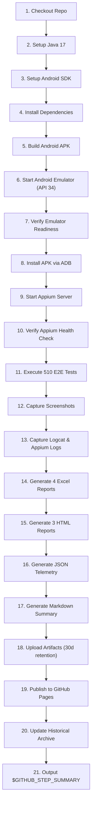

# CI/CD Execution Guide — GitHub Actions & GitHub Pages

This guide outlines how the automated CI/CD pipeline executes across 21 stages on every push, pull request, nightly schedule, and manual dispatch.

---

## 🔄 21-Stage Pipeline Execution Order

---

## ⚙️ Workflow File: `.github/workflows/android-e2e.yml`

### Triggers
1. **Push** to `main` or `master`
2. **Pull Request** to `main` or `master`
3. **Workflow Dispatch**: Run manually from GitHub Actions UI
4. **Nightly Cron**: Every night at 02:00 UTC (`cron: '0 2 * * *'`)

### Runner Environment
The pipeline runs on **`macos-13`** runners because macOS GitHub Actions runners natively support **nested hardware virtualization (HAXM/Hypervisor.framework)**, allowing Android emulators to boot in under 60 seconds with GPU acceleration!

---

## 🌐 GitHub Pages Deployment & Historical Archiving

When the pipeline succeeds on `main`:
1. Artifacts from `reports/` are pushed to the `gh-pages` branch via `peaceiris/actions-gh-pages@v3`.
2. The latest report is hosted at:
   `https://<github-username>.github.io/<repository-name>/reports/latest/execution-report.html`
3. Historical runs are archived under:
   `https://<github-username>.github.io/<repository-name>/reports/history/build-N/`
4. The root URL redirects visitors automatically to the latest execution report.

---

## 🛡️ Failure & Quality Gate Criteria
- **Pass Gate:** Pass percentage $\ge 95.0\%$.
- **Fail Gate:** If infrastructure fails (Emulator, APK install, Appium crash) or pass percentage $< 95.0\%$, the workflow fails.
