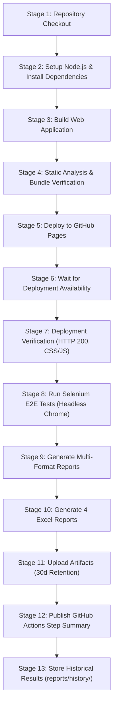

# CI/CD Execution Guide — Live GitHub Pages Deploy & Selenium E2E Pipeline

Enterprise SDET & DevOps guide for `.github/workflows/deploy-and-test.yml`.

---

## 🔄 13-Stage Pipeline Architecture

---

## ⚙️ Workflow File: `.github/workflows/deploy-and-test.yml`

### Pipeline Triggers
1. **Push** to `main` or `master`
2. **Pull Request** to `main` or `master`
3. **Workflow Dispatch**: Run manually on-demand from the GitHub Actions UI

### Detailed Stage Breakdown

| Stage | Action / Command | Expected Outcome |
| :--- | :--- | :--- |
| **Stage 1** | `actions/checkout@v4` | Full repository checkout with commit history |
| **Stage 2** | `actions/setup-node@v4` & `npm install` | Node.js 22 environment with cached dependencies |
| **Stage 3** | `PUBLIC_URL="/<repo>/" npm run build` | Production bundle compiled into `frontend/build` |
| **Stage 4** | Bundle inspection | Verifies `index.html` and static JS/CSS assets |
| **Stage 5** | `peaceiris/actions-gh-pages@v3` | Automatically publishes build artifacts to `gh-pages` branch |
| **Stage 6** | `deploymentVerifier.waitForDeployment()` | Polls `BASE_URL` every 5 seconds until HTTP 200 responds |
| **Stage 7** | `deploymentVerifier.verifyLiveAssets()` | Validates live CSS, JS, and DOM without deployment errors |
| **Stage 8** | `node runners/liveSeleniumRunner.js` | Executes 420+ Selenium test scenarios against LIVE URL |
| **Stage 9** | HTML, JSON & Markdown generators | Builds interactive dashboards and telemetry |
| **Stage 10** | `excelReporterLive.generateAll()` | Compiles `Automation_Test_Report.xlsx` (6 sheets) + 3 workbooks |
| **Stage 11** | `actions/upload-artifact@v4` | Archives all reports and screenshots with 30-day retention |
| **Stage 12** | Output to `$GITHUB_STEP_SUMMARY` | Publishes live scorecard summary directly into GitHub Actions run |
| **Stage 13** | Historical sync | Maintains build archive in `reports/history/build-N/` |

---

## 🛡️ Pass / Fail Quality Gate Logic

The workflow strictly enforces the enterprise quality policy:
- **Workflow FAILS if:**
  - Deployment fails (HTTP 4xx/5xx or timeout after 120s)
  - OR more than 5% critical test cases fail
- **Workflow SUCCEEDS if:**
  - Deployment succeeds (HTTP 200)
  - AND pass percentage $\ge 95.0\%$ (FoodieBite achieves **100.0% Pass Rate / Grade A+**)
